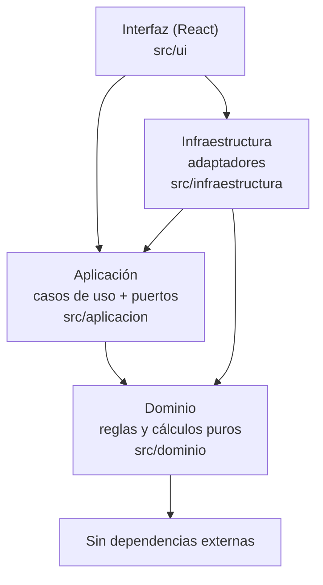

# Arquitectura de QoriGo

Aplicación PWA local con arquitectura hexagonal pragmática. El objetivo es que
las reglas de negocio no dependan de IndexedDB, del navegador ni de React.

## Capas y regla de dependencia



Regla: **las flechas de importación solo apuntan hacia el dominio**.

| Capa | Puede importar | No puede importar |
| --- | --- | --- |
| `dominio` | Solo dominio | Aplicación, infraestructura, UI, React, Dexie |
| `aplicacion` | Dominio y sus propios puertos | Infraestructura, UI, React, Dexie |
| `infraestructura` | Dominio, aplicación y librerías externas | UI |
| `ui` | Aplicación, infraestructura y dominio | — |

La prueba `src/pruebas/arquitectura.test.ts` verifica estas reglas y falla si
alguien introduce una dependencia prohibida.

## Estructura

```
src/
  dominio/
    modelo.ts              entidades y tipos del negocio
    dinero.ts              aritmética en céntimos
    fechas.ts              periodos, vencimientos y zona America/Lima
    errores.ts             errores de negocio
    pagos.ts               planificación pura de aplicaciones y estados
    prestamo.ts            cronograma, exigible y resumen de préstamos
    recordatorios.ts       política pura de avisos
    informes.ts            cálculos puros de balance e informes
    saldos.ts              cálculo de saldos a partir de aplicaciones
  aplicacion/
    puertos/
      persistencia.ts      puerto de colecciones/transacciones locales
      notificador.ts       puerto de notificaciones
      imagen.ts            puerto de procesamiento de imágenes
    personas.ts            casos de uso de personas
    suscripciones.ts       casos de uso de suscripciones
    miembros.ts            casos de uso de membresías
    cargos.ts              generación idempotente de cargos
    prestamos.ts           casos de uso de préstamos
    pagos.ts               registro, anulación e historial de pagos
    reportes.ts            orquesta la carga de datos y llama al dominio
    notificaciones.ts      orquesta recordatorios y configuración
    respaldo.ts            exportación JSON
    importacion.ts         validación y aplicación de respaldos
    sesion.ts              acceso local
    auditoria.ts           servicio de auditoría y configuración
  infraestructura/
    persistencia/
      baseDatos.ts         adaptador Dexie/IndexedDB
      semilla.ts           catálogos iniciales
    imagen/
      comprobantes.ts      procesamiento con Canvas/CompressionStream
    notificaciones/
      navegador.ts         Web Notifications + service worker
    navegador/
      almacenamiento.ts    persistencia y estimación de cuota
  ui/
    ...                    React, composición y presentación
```

## Puertos y adaptadores

| Puerto | Adaptador | Uso |
| --- | --- | --- |
| `DatosQoriGo` | `BaseDatos` (Dexie) | Persistencia local y transacciones |
| `Notificador` | `notificadorNavegador` | Notificaciones del sistema |
| `ProcesadorImagen` | `procesarComprobante` | Reducción a PNG 100×100 |

Los puertos viven en `aplicacion/puertos` y usan tipos del dominio. La
aplicación recibe objetos que cumplen el puerto; no conoce Dexie ni la API de
notificaciones.

`BaseDatos` cumple `DatosQoriGo` de forma estructural, por lo que las pruebas y
la interfaz pueden inyectarla directamente sin un adaptador adicional.

## Principios SOLID aplicados

- **SRP:** cálculos financieros en módulos de dominio; los casos de uso cargan,
  validan el flujo y persisten.
- **OCP:** un nuevo notificador (por ejemplo, push) implementa `Notificador` sin
  modificar los casos de uso.
- **LSP:** cualquier implementación de un puerto puede sustituirse en pruebas
  por un doble sin cambiar el comportamiento esperado.
- **ISP:** puertos pequeños y específicos (`Notificador`, `ProcesadorImagen`,
  `DatosQoriGo`) en lugar de una interfaz gigante.
- **DIP:** aplicación y dominio no importan Dexie, React ni el navegador.

## Pruebas

```bash
npm test
```

- `src/pruebas/cuXX.test.ts`: pruebas de aceptación por caso de uso.
- `src/pruebas/notificaciones.test.ts`: recordatorios con un notificador falso.
- `src/pruebas/arquitectura.test.ts`: regla de dependencias entre capas.
- `src/pruebas/base.test.ts`: base local y aritmética monetaria.

Antes de fusionar un cambio se ejecutan `tsc --noEmit`, `npm test` y
`npm run build`.
