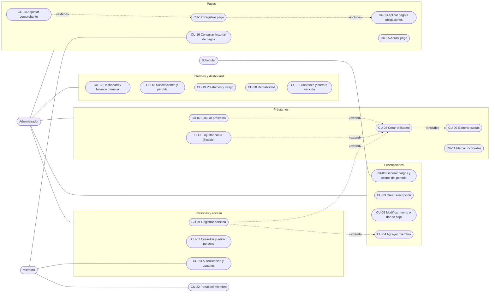
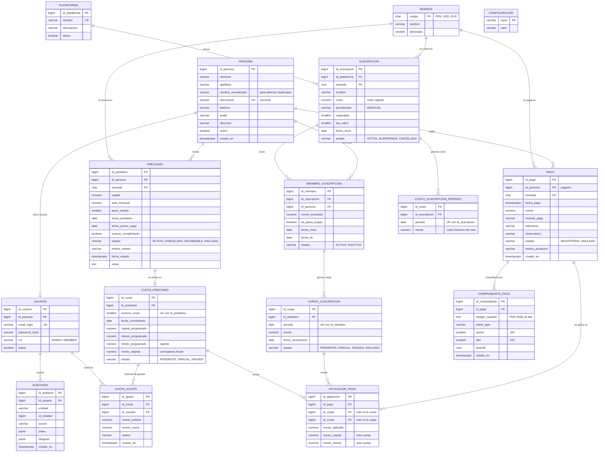
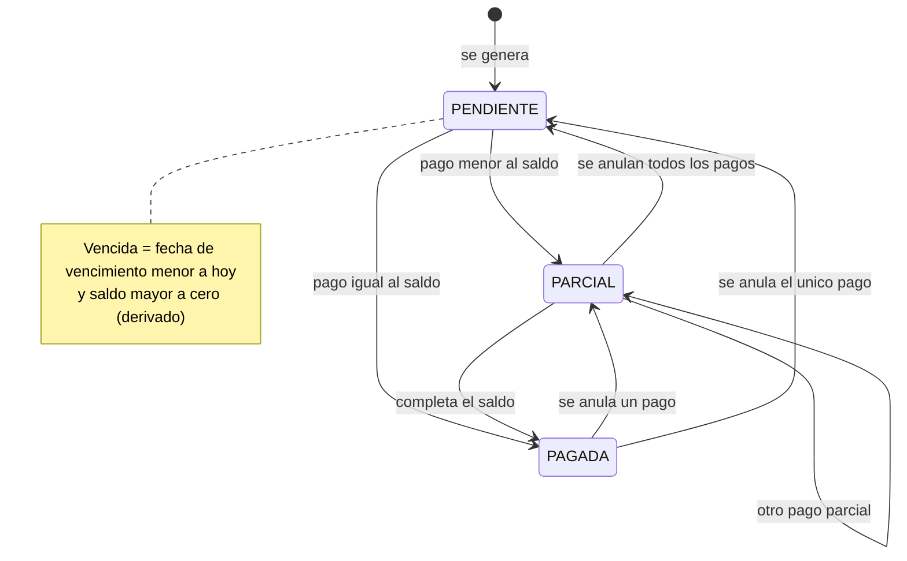
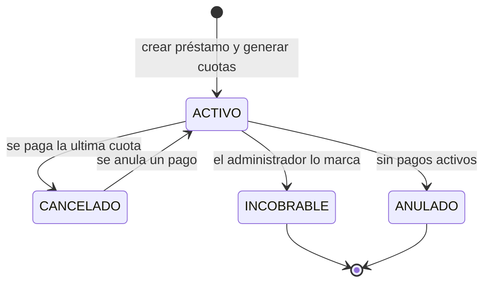
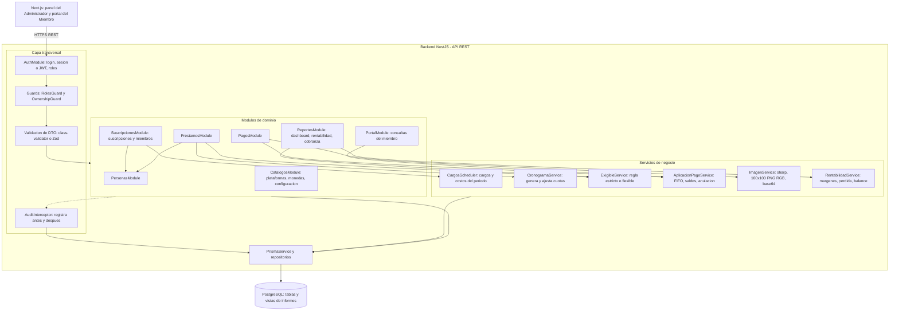
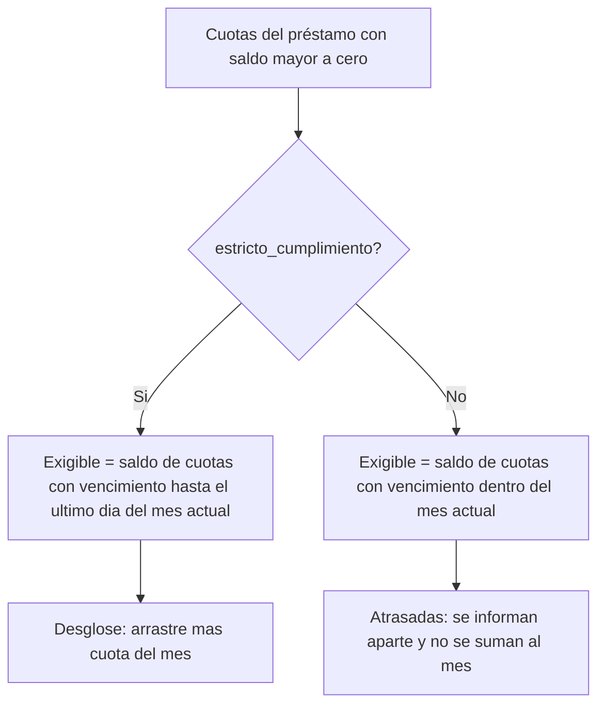
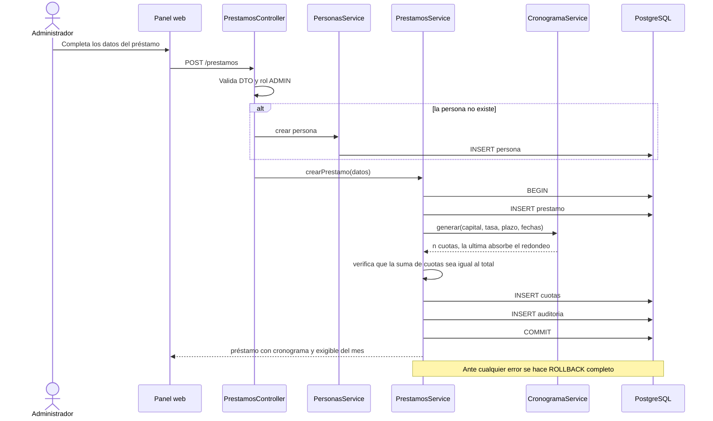
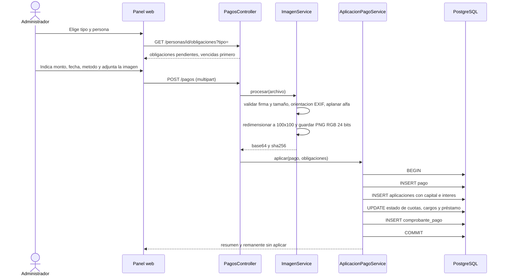
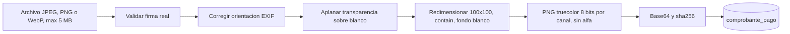

# Plan v2 – App de gestión de suscripciones, préstamos y pagos

Refinamiento del plan v1 y del brief. Incluye los cambios solicitados: cuotas automáticas, comprobantes en base64 de 100×100, préstamos de cumplimiento estricto o flexible, tarifas por miembro, informes de pérdida, rentabilidad y balance mensual. Fecha de referencia: 24/11/2026.

> **Nota de alcance (26/11/2026).** La arquitectura final es una **PWA local sin backend**. PostgreSQL, NestJS, la autenticación remota y el despliegue con servidor de las secciones 1 a 12 quedan reemplazados por la sección 13. Las reglas financieras, cálculos y casos de uso CU-01 a CU-23 se mantienen, con las adaptaciones de CU-22 y CU-23 indicadas en 13.7.

## 0. Qué cambia respecto a la v1

| Tema | v1 | v2 |
| --- | --- | --- |
| Cuotas de préstamo | Generación automática | Se mantiene y se añade la modalidad **estricto** o **flexible**, con ajustes de cuota auditados |
| Cuotas vencidas | Estado “vencida” persistido | “Vencida” pasa a ser un dato **derivado** (fecha de vencimiento < hoy y saldo > 0). En estricto cumplimiento, lo vencido se suma a lo exigible del mes actual |
| Comprobantes | Archivo externo con ruta (Storage) | Imagen **100×100 px, RGB 24 bits** (PNG sin alfa), en **base64 dentro de la BD**. Se elimina el Storage del diseño |
| Tarifa por miembro | `monto_acordado` | Se mantiene, y se añaden **plaza propia**, **cobertura** (acordado vs. costo) y alerta de déficit |
| Costos | No modelados | Nueva tabla de **costo por periodo** de cada suscripción (para medir pérdida y rentabilidad) |
| Aplicación de pagos | Monto aplicado | Se añade el desglose **capital / interés** en cada aplicación a cuotas |
| Pago | Sin pagador | Se añade `id_persona` (pagador), útil para validar y para el portal |
| Estados de préstamo | Activo, cancelado, vencido | ACTIVO, CANCELADO, **INCOBRABLE**, ANULADO (vencido es derivado) |
| Reportes | Dashboard genérico | Pérdida por suscripción, pérdida y riesgo por préstamo, rentabilidad y balance mensual |

Se conserva todo lo demás de la v1: PostgreSQL, web responsive, NestJS + Next.js, interés simple mensual sobre el capital original, pagos parciales y múltiples, multimoneda, roles ADMIN y MEMBER.

## 1. Alcance, actores y decisiones

### 1.1 Actores

| Actor | Descripción |
| --- | --- |
| Administrador | Tú. Gestiona personas, suscripciones, préstamos, pagos e informes. |
| Miembro | Persona con cuenta. Portal de solo lectura de sus propias obligaciones, pagos y comprobantes. |
| Scheduler (sistema) | Proceso diario que genera cargos y costos del periodo, y recalcula alertas. |

### 1.2 Decisiones vigentes

| Decisión | Valor |
| --- | --- |
| Base de datos | PostgreSQL |
| Aplicación | Web responsive |
| Interés | Simple mensual sobre capital original (tu 10 % × 2 meses = 20 % total) |
| Pagos | Parciales y múltiples |
| Moneda | Cada obligación tiene su moneda. **Los informes no convierten monedas**: se muestran por moneda (PEN por defecto) |
| Zona horaria | `America/Lima` para definir “mes actual”, vencimientos y el scheduler |
| Periodicidad de suscripciones | Solo MENSUAL en esta versión (el campo queda previsto para ampliarlo) |

## 2. Definiciones financieras

Estas definiciones fijan el significado exacto de los informes. Son lo más importante de validar antes de programar.

| Concepto | Definición |
| --- | --- |
| Interés total del préstamo | `I = C × (r/100) × n`; total a cobrar `T = C + I` |
| Saldo de una obligación | Monto programado − suma de aplicaciones de pagos no anulados |
| Vencida | Fecha de vencimiento < hoy y saldo > 0 |
| Exigible del mes (préstamo estricto) | Saldo de todas las cuotas con vencimiento ≤ último día del mes actual. Se desglosa en **arrastre** (vencimiento anterior al mes) y **cuota del mes** |
| Exigible del mes (préstamo flexible) | Saldo de las cuotas con vencimiento dentro del mes actual. Las atrasadas siguen visibles como “atrasadas”, pero no se suman al mes |
| Cobertura de suscripción | Σ monto acordado de miembros activos − costo de la suscripción. Negativa = déficit de tarifa |
| Margen real de suscripción (periodo) | Cobrado del periodo − costo del periodo |
| Margen proyectado de suscripción | Esperado del periodo − costo del periodo (igual a la cobertura) |
| Causa de pérdida en suscripción | **TARIFA** (esperado < costo), **MOROSIDAD** (esperado ≥ costo, pero cobrado < costo) o **AMBAS** |
| Interés cobrado | Σ `monto_interes` de las aplicaciones a cuotas. En cada aplicación el pago se reparte entre capital e interés en la misma proporción que tiene la cuota |
| Capital recuperado | Σ `monto_capital` de las aplicaciones a cuotas |
| Resultado de un préstamo | Total cobrado − capital desembolsado. Negativo mientras está activo significa “aún no recuperó el capital”, **no** pérdida |
| Préstamo en riesgo | Tiene saldo vencido y su mayor atraso supera el umbral configurable (por defecto 30 días) |
| Préstamo en pérdida | Marcado como INCOBRABLE. Pérdida neta = máx(0, capital − total cobrado) |
| Balance mensual (caja) | Ingresos del mes − egresos del mes (ver abajo) |
| Resultado económico del mes | Margen real de suscripciones + interés cobrado − pérdidas por incobrables registradas en el mes |
| Rentabilidad % | Resultado económico ÷ (costos de suscripciones del mes + capital en la calle al cierre) |

**Balance de caja del mes**

- Ingresos: pagos recibidos en el mes (por `fecha_pago`, no anulados), de suscripciones y de préstamos (capital + interés).
- Egresos: costos de suscripciones del periodo + capital desembolsado en préstamos durante el mes.

**Por qué hay dos medidas.** Prestar S/ 2,000 hace negativo el balance de caja de ese mes aunque no sea una pérdida. Por eso el dashboard muestra **Balance de caja** y **Resultado económico** por separado, con la definición visible en cada indicador.

## 3. Reglas de negocio

### 3.1 Suscripciones y miembros

| ID | Regla |
| --- | --- |
| RN-S01 | Miembros activos (incluida la plaza propia) ≤ capacidad. Se valida dentro de una transacción bloqueando la fila de la suscripción. |
| RN-S02 | El `monto_acordado` es individual y puede ser distinto del costo por plaza. Ejemplo: plan de S/ 30 con 5 plazas, uno paga 10 y los otros cuatro pagan 5 (10 + 4×5 = 30): cobertura 0, sin pérdida. |
| RN-S03 | Si cobertura < 0 se muestra alerta de **déficit proyectado**. No bloquea el alta. |
| RN-S04 | **Plaza propia**: ocupa una plaza, no genera cargos y su costo queda absorbido por ti. Aplica a Obsidian (1 plaza, solo tú) y a plazas que usas personalmente. |
| RN-S05 | Una persona no puede tener dos membresías activas en la misma suscripción (índice único parcial). |
| RN-S06 | Cambiar el monto acordado rige desde el siguiente periodo no generado. Los cargos ya generados no cambian, salvo ajuste explícito y auditado. |
| RN-S07 | El scheduler genera, de forma idempotente, el cargo de cada miembro y el costo del periodo (únicos por miembro-periodo y suscripción-periodo). |
| RN-S08 | Al dar de baja a un miembro (`fecha_fin`) no se generan más cargos; los pendientes se conservan. |
| RN-S09 | Las deudas de suscripción de meses anteriores siempre se mantienen como pendientes (no existe la bandera estricto para suscripciones). |

### 3.2 Préstamos y cuotas

| ID | Regla |
| --- | --- |
| RN-P01 | Al crear un préstamo se generan **todas** sus cuotas en la misma transacción. Si algo falla, se revierte todo. |
| RN-P02 | Redondeo: capital e interés base de cada cuota se truncan a 2 decimales; la **última cuota** absorbe la diferencia. La suma de cuotas es exactamente `T`. Ej.: S/ 2,600 en 6 cuotas = 5 × 433.33 + 433.35. |
| RN-P03 | Vencimiento de la cuota *i* = `fecha_primer_pago` + (*i*−1) meses, ajustando al último día del mes si hace falta (31 → 30 o 28). Por defecto, `fecha_primer_pago` = `fecha_prestamo` + 1 mes. |
| RN-P04 | `estricto_cumplimiento` (booleano) define cómo se calcula lo exigible del mes (ver sección 2). |
| RN-P05 | **Estricto**: la cuota no pagada pasa al mes siguiente y se suma a su exigible. No se puede editar el monto de las cuotas. |
| RN-P06 | **Flexible**: se puede variar el monto de cuotas pendientes o parciales. Lo atrasado no se acumula al mes, pero sí se informa. |
| RN-P07 | Ajuste de cuota (solo flexible): el nuevo monto debe ser ≥ lo ya aplicado a esa cuota; la suma total del préstamo se mantiene; la diferencia se redistribuye entre las cuotas pendientes posteriores (equitativamente) o en la última; capital e interés de la cuota se reparten en la proporción global C/T. Cada cambio guarda monto anterior, nuevo, motivo, usuario y fecha. |
| RN-P08 | El préstamo pasa a CANCELADO automáticamente cuando todas sus cuotas están pagadas. |
| RN-P09 | **INCOBRABLE** lo marca el administrador con motivo. Deja de generar alertas y registra la pérdida neta. |
| RN-P10 | Un préstamo solo se anula (ANULADO) si no tiene pagos activos. |
| RN-P11 | Cambiar la bandera estricto/flexible después de creado el préstamo está permitido y se audita. Solo afecta al cálculo de lo exigible. |

### 3.3 Pagos

| ID | Regla |
| --- | --- |
| RN-G01 | Monto > 0. La moneda del pago debe coincidir con la de las obligaciones aplicadas. |
| RN-G02 | Suma de aplicaciones ≤ monto del pago. El remanente sin aplicar se muestra como alerta. |
| RN-G03 | Cada aplicación ≤ saldo pendiente de su obligación. |
| RN-G04 | La aplicación se sugiere automáticamente por antigüedad (primero lo más vencido); el administrador puede cambiarla. |
| RN-G05 | Cada pago pertenece a una persona (pagador). Solo puede aplicarse a obligaciones de esa persona. |
| RN-G06 | El periodo se deduce de la obligación aplicada. Desaparece el campo manual “Mes” de la bitácora. |
| RN-G07 | Anular un pago: estado ANULADO con motivo, reversión de sus aplicaciones y recálculo de estados. Nunca se borra. |

### 3.4 Comprobantes (imagen)

| ID | Regla |
| --- | --- |
| RN-I01 | Entrada: JPEG, PNG o WebP, máximo 5 MB. Se valida por contenido real (firma del archivo), no por extensión. |
| RN-I02 | Procesamiento obligatorio **en el backend** antes de guardar: corregir orientación EXIF → aplanar transparencia sobre fondo blanco → redimensionar a **100×100 px** (ajuste “contain”, con fondo blanco, sin recortar ni deformar) → **PNG truecolor 8 bits por canal, sin alfa (24 bits RGB)** → base64. |
| RN-I03 | Se guarda solo el resultado procesado (base64 sin prefijo `data:`), con `mime_type`, `ancho`, `alto` y `sha256`. El original se descarta. |
| RN-I04 | Máximo 3 comprobantes por pago. Un `sha256` repetido genera advertencia de posible duplicado. |
| RN-I05 | Los listados nunca incluyen el base64. Se obtiene con un endpoint dedicado. |

**Advertencia de diseño.** Una captura de Yape o un voucher reducido a 100×100 px **no es legible**; sirve como miniatura de evidencia. Para compensarlo, el número de operación (`referencia`) se registra como texto, y es recomendable hacerlo obligatorio para pagos por Yape, Plin o transferencia. Si más adelante quieres leer el comprobante, basta con cambiar el tamaño en la configuración (por ejemplo 400×400); el diseño no cambia.

## 4. Requerimientos funcionales

Prioridad: **M** = imprescindible, **S** = recomendable, **C** = opcional.

### 4.1 Personas

| ID | Requerimiento | Prior. |
| --- | --- | --- |
| RF-PER-01 | Crear persona (nombres y apellidos obligatorios; documento, teléfono, email y dirección opcionales). | M |
| RF-PER-02 | Evitar duplicados: documento único si se informa, y alerta por nombre y apellidos similares (sin tildes ni mayúsculas). | M |
| RF-PER-03 | Editar y desactivar personas. No se eliminan si tienen movimientos. | M |
| RF-PER-04 | Buscar y listar con paginación y filtro por estado. | M |
| RF-PER-05 | Crear persona “al vuelo” desde el alta de un miembro o de un préstamo si no existe. | M |
| RF-PER-06 | Ficha de persona: suscripciones, préstamos, deuda total, pagos recientes. | S |
| RF-PER-07 | Crear usuario de acceso (rol MEMBER) para una persona. | S |

### 4.2 Catálogos

| ID | Requerimiento | Prior. |
| --- | --- | --- |
| RF-CAT-01 | CRUD de plataformas (YouTube, Microsoft, Obsidian…). | M |
| RF-CAT-02 | Catálogo de monedas precargado (PEN, USD, EUR). | M |
| RF-CAT-03 | Parámetros: métodos de pago, umbral de “en riesgo” (30 días), tamaño de imagen, obligatoriedad de comprobante por método. | S |

### 4.3 Suscripciones, miembros y cargos

| ID | Requerimiento | Prior. |
| --- | --- | --- |
| RF-SUS-01 | Crear suscripción: plataforma, nombre, costo, moneda, capacidad, fecha de inicio, día de cobro. | M |
| RF-SUS-02 | Editar el costo con vigencia desde el siguiente periodo, conservando el histórico. | M |
| RF-SUS-03 | Cambiar estado: activa, suspendida, cancelada. | M |
| RF-SUS-04 | Agregar miembro: elegir persona existente o crearla; validar capacidad y duplicado. | M |
| RF-SUS-05 | Definir monto acordado individual por miembro. | M |
| RF-SUS-06 | Marcar una membresía como plaza propia. | M |
| RF-SUS-07 | Modificar monto de un miembro y darlo de baja. | M |
| RF-SUS-08 | Detalle de suscripción con plazas ocupadas y libres, costo base por plaza, cobertura y alerta de déficit. | M |
| RF-SUS-09 | Listado con esperado, cobrado y pendiente del mes por suscripción. | M |
| RF-CAR-01 | Generación mensual automática, idempotente, de cargos y costo del periodo. | M |
| RF-CAR-02 | Regenerar o completar un periodo manualmente (por ejemplo, tras agregar un miembro). | S |
| RF-CAR-03 | Ajustar o condonar un cargo con motivo, auditado. | S |
| RF-CAR-04 | Consultar cargos pendientes y vencidos por persona y por suscripción. | M |

### 4.4 Préstamos

| ID | Requerimiento | Prior. |
| --- | --- | --- |
| RF-PRE-01 | Crear préstamo: persona (existente o nueva), capital, tasa mensual, plazo, fecha de préstamo, fecha del primer pago, moneda, bandera de estricto cumplimiento, notas. | M |
| RF-PRE-02 | Simulación previa sin guardar, con cronograma completo. | M |
| RF-PRE-03 | Generación automática y transaccional de las cuotas (RN-P01 a RN-P03). | M |
| RF-PRE-04 | Cronograma visible con estado, pagado y saldo por cuota. | M |
| RF-PRE-05 | Lo exigible del mes según la bandera, con desglose arrastre y cuota del mes. | M |
| RF-PRE-06 | Ajustar el monto de cuotas en préstamos flexibles con redistribución y auditoría. | M |
| RF-PRE-07 | Cambiar la bandera estricto/flexible con auditoría. | S |
| RF-PRE-08 | Cancelación automática al pagar la última cuota. | M |
| RF-PRE-09 | Marcar préstamo como incobrable con motivo. | M |
| RF-PRE-10 | Anular préstamo sin pagos. | S |
| RF-PRE-11 | Alertas de cuotas por vencer (7 días) y vencidas. | S |
| RF-PRE-12 | Resumen del préstamo: total cobrado, pendiente, capital recuperado, interés cobrado, resultado. | M |

### 4.5 Pagos y comprobantes

| ID | Requerimiento | Prior. |
| --- | --- | --- |
| RF-PAG-01 | Registrar pago eligiendo el **tipo** (Suscripción o Préstamo), la persona, monto, fecha, método, referencia y observación. | M |
| RF-PAG-02 | Mostrar las obligaciones pendientes de la persona según el tipo, con lo vencido primero. | M |
| RF-PAG-03 | Aplicación automática por antigüedad, editable manualmente. | M |
| RF-PAG-04 | Pagos parciales y pagos que cubren varias obligaciones. | M |
| RF-PAG-05 | Adjuntar comprobante; la obligatoriedad se configura por método de pago. | M |
| RF-PAG-06 | Mostrar el remanente sin aplicar. | M |
| RF-PAG-07 | Anular pago con motivo y reversión controlada. | M |
| RF-PAG-08 | Historial de pagos con filtros (persona, tipo, método, fechas, estado). | M |
| RF-PAG-09 | Ver comprobante ampliado en pantalla (con aviso de miniatura). | M |
| RF-IMG-01 | Procesar la imagen según RN-I01 a RN-I05 y guardarla en base64. | M |
| RF-IMG-02 | Advertir al usuario cuando el sha256 coincide con un comprobante ya registrado. | S |

### 4.5 Informes y dashboard

| ID | Requerimiento | Prior. |
| --- | --- | --- |
| RF-REP-01 | **Informe de suscripciones**: por suscripción y periodo, costo, esperado, cobrado, margen real, margen proyectado y causa de pérdida. | M |
| RF-REP-02 | **Pérdida en suscripciones**: solo las que están en pérdida, con detalle por miembro (quién debe y quién aporta menos que su costo por plaza). | M |
| RF-REP-03 | **Informe de préstamos**: capital, cobrado, interés cobrado, saldo, vencido, días de atraso, estado, resultado y marcas EN RIESGO / EN PÉRDIDA. | M |
| RF-REP-04 | **Rentabilidad**: por suscripción, por préstamo, por persona, por periodo y global. | M |
| RF-REP-05 | Cobranza: exigible del mes y lista de morosos. | M |
| RF-REP-06 | Antigüedad de la cartera vencida (1–30, 31–60, 61–90, más de 90 días). | S |
| RF-REP-07 | Filtros por periodo, moneda y persona; exportación a CSV. | S |
| RF-DAS-01 | **Balance mensual** (caja) del mes seleccionado, con serie de los últimos 12 meses. | M |
| RF-DAS-02 | Resultado económico y rentabilidad % del mes. | M |
| RF-DAS-03 | Desglose por origen: suscripciones vs. préstamos; ingresos vs. egresos. | M |
| RF-DAS-04 | Indicadores: exigible del mes, cobrado del mes, % de cobranza, total vencido, capital en la calle. | M |
| RF-DAS-05 | Alertas: suscripciones en pérdida, préstamos en riesgo, cuotas por vencer. | M |
| RF-DAS-06 | Cada indicador muestra su definición (tooltip). | S |

### 4.6 Seguridad y auditoría

| ID | Requerimiento | Prior. |
| --- | --- | --- |
| RF-SEG-01 | Login, roles ADMIN y MEMBER, cierre de sesión y recuperación de contraseña. | M |
| RF-SEG-02 | Portal del miembro de solo lectura: sus suscripciones, cuotas, pagos y comprobantes. | S |
| RF-SEG-03 | La identidad sale siempre de la sesión, nunca de un `id_persona` enviado por el cliente. | M |
| RF-AUD-01 | Auditar creación, modificación, ajuste y anulación de entidades financieras (quién, cuándo, antes y después). | M |

### 4.7 Requerimientos no funcionales

| ID | Requerimiento |
| --- | --- |
| RNF-01 | Importes en `NUMERIC`, nunca en `FLOAT`. Operaciones financieras dentro de transacciones. |
| RNF-02 | Contraseñas con argon2 o bcrypt, HTTPS, autorización por rol en el backend, límite de intentos de login. |
| RNF-03 | Dashboard en menos de 2 segundos con el volumen esperado, usando vistas e índices. |
| RNF-04 | Procesar imágenes sin bloquear el servidor (librería nativa como `sharp`) y con límite de tamaño de subida. |
| RNF-05 | Copias de seguridad diarias de la base de datos. Como las imágenes viven en ella, también quedan respaldadas. |
| RNF-06 | Interfaz responsive, pensada para registrar pagos desde el celular. |
| RNF-07 | Fechas con zona horaria `America/Lima`; timestamps en `TIMESTAMPTZ`. |

## 5. Casos de uso

### 5.1 Diagrama de casos de uso

Mermaid no tiene un diagrama UML de casos de uso nativo; se representa con un `flowchart` en el que los óvalos son casos de uso. Las líneas punteadas indican `«include»` (flecha del caso base al incluido) y `«extend»` (flecha de la extensión al caso base).



### 5.2 Catálogo de casos de uso

| ID | Caso de uso | Actor | Requerimientos |
| --- | --- | --- | --- |
| CU-01 | Registrar persona | Administrador | RF-PER-01, 02, 05 |
| CU-02 | Consultar y editar persona | Administrador | RF-PER-03, 04, 06 |
| CU-03 | Crear suscripción | Administrador | RF-SUS-01, 02, 03 |
| CU-04 | Agregar miembro a una suscripción | Administrador | RF-SUS-04, 05, 06, 08 |
| CU-05 | Modificar monto o dar de baja a un miembro | Administrador | RF-SUS-07 |
| CU-06 | Generar cargos y costos del periodo | Scheduler, Administrador | RF-CAR-01, 02 |
| CU-07 | Simular préstamo | Administrador | RF-PRE-02 |
| CU-08 | Crear préstamo | Administrador | RF-PRE-01, 04, 05 |
| CU-09 | Generar cuotas (incluido en CU-08) | Sistema | RF-PRE-03 |
| CU-10 | Ajustar cuota en préstamo flexible | Administrador | RF-PRE-06, 07 |
| CU-11 | Marcar préstamo como incobrable | Administrador | RF-PRE-09, 10 |
| CU-12 | Registrar pago | Administrador | RF-PAG-01, 04, 06 |
| CU-13 | Aplicar pago a obligaciones (incluido en CU-12) | Sistema, Administrador | RF-PAG-02, 03 |
| CU-14 | Adjuntar comprobante | Administrador | RF-PAG-05, RF-IMG-01, 02 |
| CU-15 | Anular pago | Administrador | RF-PAG-07 |
| CU-16 | Consultar historial de pagos | Administrador, Miembro (solo lo propio) | RF-PAG-08, 09 |
| CU-17 | Ver dashboard y balance mensual | Administrador | RF-DAS-01 a 06 |
| CU-18 | Informe de suscripciones y pérdida | Administrador | RF-REP-01, 02 |
| CU-19 | Informe de préstamos y riesgo | Administrador | RF-REP-03, RF-PRE-11, 12 |
| CU-20 | Informe de rentabilidad | Administrador | RF-REP-04 |
| CU-21 | Informe de cobranza y cartera vencida | Administrador | RF-REP-05, 06 |
| CU-22 | Portal del miembro | Miembro | RF-SEG-02 |
| CU-23 | Autenticación y gestión de usuarios | Administrador, Miembro | RF-SEG-01, 03, RF-PER-07 |

### 5.3 Especificación de los casos de uso principales

#### CU-01 Registrar persona

**Actor:** Administrador. **Precondición:** sesión de administrador.

**Flujo principal**

1. El administrador abre “Nueva persona” e ingresa nombres y apellidos (y, opcionalmente, documento, teléfono, email y dirección).
2. El sistema normaliza nombres y apellidos (sin tildes ni mayúsculas) y busca coincidencias.
3. No hay coincidencias: el sistema guarda la persona como activa.

**Flujos alternos**

- 2a. El documento ya existe: se rechaza y se muestra la persona existente.
- 2b. Hay un nombre y apellidos similares: se muestra la lista y el administrador elige “usar existente” o “crear de todos modos”.

**Postcondición:** persona creada, con auditoría. **Nota:** este caso se invoca también desde CU-04 y CU-08 cuando la persona no existe.

#### CU-03 Crear suscripción

**Actor:** Administrador. **Precondición:** existe la plataforma y la moneda.

**Flujo principal**

1. El administrador elige plataforma y completa nombre, costo, moneda, capacidad, fecha de inicio y día de cobro.
2. El sistema valida costo > 0 y capacidad ≥ 1.
3. El sistema crea la suscripción en estado ACTIVA y registra el costo vigente.
4. El sistema muestra el detalle con plazas libres, costo base por plaza (costo ÷ capacidad) y cobertura 0 (aún sin miembros).

**Flujo alterno:** 2a. Datos inválidos: se informa el campo y no se guarda.

**Postcondición:** suscripción creada; el costo del periodo se generará con CU-06.

#### CU-04 Agregar miembro a una suscripción

**Actor:** Administrador. **Precondición:** suscripción ACTIVA.

**Flujo principal**

1. El administrador busca una persona por nombre o documento.
2. Elige la persona (o marca “plaza propia” si la plaza es para él) e indica el monto acordado y la fecha de inicio.
3. El sistema bloquea la suscripción, valida capacidad (RN-S01) y que no haya membresía activa duplicada (RN-S05).
4. El sistema crea la membresía y recalcula la cobertura.
5. Si la cobertura es negativa, muestra alerta de déficit (RN-S03) sin bloquear.

**Flujos alternos**

- 1a. La persona no existe: se ejecuta CU-01 desde la misma pantalla y se continúa con la persona recién creada.
- 3a. Sin plazas libres: se rechaza con mensaje.
- 2b. Plaza propia: el monto se fija en 0 y no se generarán cargos (RN-S04).

**Postcondición:** membresía creada. Si el periodo actual ya tiene cargos generados, se ofrece generar el del nuevo miembro (CU-06, RF-CAR-02).

#### CU-06 Generar cargos y costos del periodo

**Actor:** Scheduler (o Administrador manualmente). **Precondición:** suscripciones ACTIVAS.

**Flujo principal**

1. Cada día, el scheduler evalúa las suscripciones cuyo periodo aún no tiene cargos y cuya fecha de cobro llegó.
2. Para cada suscripción inserta un registro de costo del periodo con el costo vigente.
3. Para cada miembro activo con monto > 0 (excluye plaza propia), inserta un cargo con su monto acordado y su vencimiento.
4. Registra el resultado en auditoría.

**Reglas:** es idempotente (únicos por suscripción-periodo y miembro-periodo), de modo que reejecutarlo no duplica nada. Un fallo en una suscripción no impide procesar las demás.

#### CU-07 y CU-08 Simular y crear préstamo (incluye CU-09)

**Actor:** Administrador. **Precondición:** sesión de administrador.

**Flujo principal**

1. El administrador ingresa persona, capital, tasa mensual, plazo, fecha de préstamo, fecha del primer pago (por defecto, +1 mes), moneda y la bandera **estricto cumplimiento**.
2. **Simular (CU-07):** el sistema calcula y muestra el cronograma completo sin guardar nada. Se puede repetir cambiando datos.
3. **Crear (CU-08):** el administrador confirma. En **una transacción** el sistema:
   1. inserta el préstamo en estado ACTIVO;
   2. calcula `I = C × r/100 × n` y `T = C + I`;
   3. **(CU-09)** genera las *n* cuotas con capital, interés y vencimiento (RN-P02 y RN-P03); la última absorbe el redondeo;
   4. verifica que la suma de cuotas sea igual a `T`;
   5. confirma la transacción y registra auditoría.
4. El sistema muestra el cronograma y lo exigible del mes.

**Flujos alternos**

- 1a. La persona no existe: se ejecuta CU-01.
- 3a. Falla la generación de una cuota o la verificación del total: se revierte todo y no queda un préstamo sin cuotas.

**Ejemplo (PM-2):** C = 2,000; r = 5 %; n = 6. I = 600; T = 2,600; cuotas 433.33 × 5 y 433.35.

#### CU-10 Ajustar cuota en préstamo flexible

**Actor:** Administrador. **Precondición:** préstamo ACTIVO con `estricto_cumplimiento = false`.

**Flujo principal**

1. El administrador abre el cronograma y elige una cuota PENDIENTE o PARCIAL.
2. Ingresa el nuevo monto y el motivo, y escoge dónde se redistribuye la diferencia (equitativamente en las cuotas posteriores, o en la última).
3. El sistema valida RN-P07 y muestra una vista previa del nuevo cronograma.
4. Al confirmar, en una transacción actualiza las cuotas afectadas, mantiene la suma total y guarda el histórico del ajuste.

**Flujos alternos**

- 3a. El monto es menor a lo ya aplicado a la cuota, o no hay cuotas posteriores donde redistribuir: se rechaza.
- 1a. El préstamo es estricto: la opción no se ofrece. Si hace falta, se cambia primero la bandera (RN-P11, auditado).

#### CU-12 a CU-14 Registrar pago con comprobante

**Actor:** Administrador. **Precondición:** la persona tiene obligaciones pendientes del tipo elegido.

**Flujo principal**

1. El administrador elige el **tipo** (Suscripción o Préstamo) y la persona.
2. El sistema lista sus obligaciones pendientes de ese tipo, las vencidas primero. En préstamos estrictos muestra el desglose arrastre y cuota del mes.
3. El administrador indica monto, fecha, método, referencia y observación.
4. **(CU-13)** El sistema propone la aplicación automática por antigüedad; el administrador puede editar los importes por obligación.
5. **(CU-14)** El administrador adjunta la imagen. El backend la procesa (RN-I01 a RN-I05) y obtiene el base64 de 100×100 RGB 24 bits.
6. El sistema valida RN-G01 a RN-G05 y, en una transacción, inserta el pago, sus aplicaciones (con desglose capital/interés en cuotas), el comprobante y recalcula estados (cuota o cargo: PARCIAL o PAGADA; préstamo: CANCELADO si no quedan cuotas).
7. El sistema muestra el resumen y el remanente sin aplicar, si lo hay.

**Flujos alternos**

- 5a. Archivo inválido o mayor de 5 MB: se rechaza sin guardar el pago.
- 5b. El método exige comprobante y no se adjuntó: no se permite guardar.
- 5c. `sha256` repetido: se advierte posible duplicado y se pide confirmación.
- 6a. La aplicación supera el saldo de una obligación o el monto del pago: se rechaza.
- 4a. Pago menor a la cuota: queda PARCIAL.

**Ejemplo real:** Ernesto acordó S/ 15 y pagó S/ 14 el 01/11. El cargo de octubre queda PARCIAL con saldo S/ 1.

#### CU-15 Anular pago

**Actor:** Administrador. **Precondición:** pago en estado REGISTRADO.

1. El administrador abre el pago e indica el motivo.
2. En una transacción el sistema cambia el pago a ANULADO, revierte sus aplicaciones y recalcula los estados de las obligaciones (un préstamo CANCELADO vuelve a ACTIVO si corresponde).
3. Se registra auditoría. El comprobante se conserva para trazabilidad.

#### CU-11 Marcar préstamo como incobrable

**Actor:** Administrador. **Precondición:** préstamo ACTIVO con saldo pendiente.

1. El administrador indica el motivo.
2. El sistema cambia el estado a INCOBRABLE, congela las alertas y calcula la pérdida neta = máx(0, capital − total cobrado).
3. La pérdida entra al resultado económico del mes en que se registra.

#### CU-17 a CU-21 Informes y dashboard

**Actor:** Administrador. **Precondición:** sesión de administrador.

1. El administrador elige mes o rango de periodos y la moneda (PEN por defecto).
2. El sistema consulta las vistas de informes (sección 9) y muestra:
   - **CU-17 Dashboard:** balance de caja del mes y serie de 12 meses; resultado económico y rentabilidad %; ingresos y egresos por origen; exigible, cobrado, % de cobranza y vencido; alertas.
   - **CU-18:** por suscripción costo, esperado, cobrado, margen real y proyectado y causa de pérdida (TARIFA, MOROSIDAD, AMBAS), con detalle por miembro.
   - **CU-19:** por préstamo capital, cobrado, interés cobrado, saldo, vencido, días de atraso, resultado y marcas EN RIESGO o EN PÉRDIDA.
   - **CU-20:** rentabilidad por suscripción, préstamo, persona, periodo y global.
   - **CU-21:** exigible del mes y morosos, con antigüedad 1–30, 31–60, 61–90 y más de 90 días.
3. El administrador puede abrir el detalle de cualquier cifra y exportar a CSV.

**Flujo alterno:** sin datos en el rango, se muestran valores en cero y un mensaje, no un error.

#### CU-22 y CU-23 Portal del miembro y autenticación

1. El miembro inicia sesión (CU-23). El sistema obtiene su `id_persona` de la sesión.
2. En el portal (CU-22) ve sus suscripciones, cargos, cuotas, saldo, pagos y comprobantes.
3. Cualquier intento de consultar datos de otra persona devuelve 404, aunque modifique la URL.

## 6. Modelo de datos

### 6.1 Diagrama entidad-relación

Incluye las tablas de la v1 más las nuevas (`COSTO_SUSCRIPCION_PERIODO`, `CUOTA_AJUSTE`, `COMPROBANTE_PAGO`, `CONFIGURACION`). Los tipos se escriben sin precisión porque Mermaid no admite comas en ellos; la precisión real está en 6.3.



### 6.2 Cambios sobre el diccionario de la v1

| Tabla | Cambio | Motivo |
| --- | --- | --- |
| `PRESTAMO` | **+** `estricto_cumplimiento` (BOOLEAN, obligatorio) | Define cómo se calcula lo exigible (RN-P04 a RN-P06) |
| `PRESTAMO` | **+** `id_moneda`/`moneda`, `motivo_estado`, `fecha_estado`; estados ACTIVO, CANCELADO, INCOBRABLE, ANULADO | Trazabilidad del cierre y de la pérdida |
| `PRESTAMO` | **−** `tipo_interes`, `metodo_calculo` | Hay una sola modalidad: interés simple mensual sobre capital |
| `PRESTAMO` | `tasa_interes` pasa a `tasa_mensual` | Evita la ambigüedad que tenías (10 % × 2 meses = 20 %) |
| `CUOTA_PRESTAMO` | **+** `monto_original`; estados PENDIENTE, PARCIAL, PAGADA | Conserva el cronograma inicial; “vencida” se deriva |
| `CUOTA_AJUSTE` | **Nueva** | Historial de cambios de cuota en préstamos flexibles |
| `APLICACION_PAGO` | **+** `monto_capital`, `monto_interes` | Permite calcular interés cobrado y capital recuperado sin recalcular |
| `PAGO` | **+** `id_persona`, `moneda`, `motivo_anulacion` | Pagador, moneda y trazabilidad de anulación |
| `ARCHIVO_ADJUNTO` | Reemplazada por `COMPROBANTE_PAGO` | La imagen se guarda en base64 dentro de la BD |
| `MIEMBRO_SUSCRIPCION` | **+** `es_plaza_propia` | Plaza del administrador sin cargo |
| `COSTO_SUSCRIPCION_PERIODO` | **Nueva** | Costo histórico mensual para margen y pérdida |
| `PERSONA` | **+** `nombre_normalizado` | Búsqueda de duplicados |
| `CONFIGURACION` | **Nueva** | Umbral de riesgo, tamaño de imagen, métodos que exigen comprobante |

### 6.3 Script de las piezas nuevas o modificadas

```sql
-- Préstamos: bandera y estados
ALTER TABLE prestamo
  ADD COLUMN estricto_cumplimiento BOOLEAN NOT NULL,
  ADD COLUMN motivo_estado VARCHAR(250),
  ADD COLUMN fecha_estado TIMESTAMPTZ,
  ADD CONSTRAINT ck_prestamo_estado
    CHECK (estado IN ('ACTIVO','CANCELADO','INCOBRABLE','ANULADO'));

-- Cuotas: cronograma inicial
ALTER TABLE cuota_prestamo
  ADD COLUMN monto_original NUMERIC(12,2) NOT NULL,
  ADD CONSTRAINT ck_cuota_estado CHECK (estado IN ('PENDIENTE','PARCIAL','PAGADA')),
  ADD CONSTRAINT ck_cuota_suma CHECK (capital_programado + interes_programado = monto_programado);

-- Historial de ajustes de cuota (préstamos flexibles)
CREATE TABLE cuota_ajuste (
  id_ajuste      BIGINT GENERATED ALWAYS AS IDENTITY PRIMARY KEY,
  id_cuota       BIGINT NOT NULL REFERENCES cuota_prestamo(id_cuota),
  id_usuario     BIGINT NOT NULL REFERENCES usuario(id_usuario),
  monto_anterior NUMERIC(12,2) NOT NULL,
  monto_nuevo    NUMERIC(12,2) NOT NULL CHECK (monto_nuevo >= 0),
  motivo         VARCHAR(250) NOT NULL,
  creado_en      TIMESTAMPTZ NOT NULL DEFAULT now()
);

-- Costo histórico de cada suscripción por periodo
CREATE TABLE costo_suscripcion_periodo (
  id_costo       BIGINT GENERATED ALWAYS AS IDENTITY PRIMARY KEY,
  id_suscripcion BIGINT NOT NULL REFERENCES suscripcion(id_suscripcion),
  periodo        DATE NOT NULL CHECK (periodo = date_trunc('month', periodo)::date),
  monto          NUMERIC(10,2) NOT NULL CHECK (monto >= 0),
  UNIQUE (id_suscripcion, periodo)
);

-- Plaza propia y unicidad de membresía activa
ALTER TABLE miembro_suscripcion
  ADD COLUMN es_plaza_propia BOOLEAN NOT NULL DEFAULT FALSE,
  ADD CONSTRAINT ck_plaza_propia CHECK (NOT es_plaza_propia OR monto_acordado = 0);
CREATE UNIQUE INDEX uq_miembro_activo
  ON miembro_suscripcion (id_suscripcion, id_persona) WHERE estado = 'ACTIVO';

-- Pagador y desglose capital/interés
ALTER TABLE pago
  ADD COLUMN id_persona BIGINT NOT NULL REFERENCES persona(id_persona),
  ADD COLUMN motivo_anulacion VARCHAR(250);
ALTER TABLE aplicacion_pago
  ADD COLUMN monto_capital NUMERIC(12,2),
  ADD COLUMN monto_interes NUMERIC(12,2),
  ADD CONSTRAINT ck_aplicacion_desglose CHECK (
    (id_cuota IS NULL AND monto_capital IS NULL AND monto_interes IS NULL)
    OR (id_cuota IS NOT NULL AND monto_capital >= 0 AND monto_interes >= 0
        AND monto_capital + monto_interes = monto_aplicado));

-- Comprobantes (reemplaza archivo_adjunto)
CREATE TABLE comprobante_pago (
  id_comprobante BIGINT GENERATED ALWAYS AS IDENTITY PRIMARY KEY,
  id_pago        BIGINT NOT NULL REFERENCES pago(id_pago),
  imagen_base64  TEXT NOT NULL
                 CHECK (imagen_base64 ~ '^[A-Za-z0-9+/]+={0,2}$' AND length(imagen_base64) <= 262144),
  mime_type      VARCHAR(20) NOT NULL DEFAULT 'image/png',
  ancho          SMALLINT NOT NULL CHECK (ancho > 0),
  alto           SMALLINT NOT NULL CHECK (alto > 0),
  sha256         CHAR(64) NOT NULL,
  subido_en      TIMESTAMPTZ NOT NULL DEFAULT now()
);
CREATE INDEX ix_comprobante_pago ON comprobante_pago (id_pago);
CREATE INDEX ix_comprobante_sha  ON comprobante_pago (sha256);

-- Configuración
CREATE TABLE configuracion (clave VARCHAR(60) PRIMARY KEY, valor VARCHAR(250) NOT NULL);
INSERT INTO configuracion VALUES
  ('umbral_riesgo_dias','30'), ('imagen_ancho','100'), ('imagen_alto','100'),
  ('metodos_con_comprobante','YAPE,PLIN,TRANSFERENCIA');
```

Las reglas que dependen de otras filas (capacidad, saldo ≤ aplicación, suma de cuotas = total, monedas coherentes) se validan en el backend dentro de la transacción, como ya indicaba la v1.

### 6.4 Normalización: qué se calcula y qué se guarda

El modelo cumple 3FN: cada dato depende de la clave de su tabla y no hay nombres ni plataformas repetidos. Los campos calculados de tu tabla original (`Miembros`, `Costo/Usuario`, `Pago/Mensual`, `Monto Total`, `Intereses Total`, `Cancelado`, `Cuotas Pagadas`, `Mes`) **no se almacenan**. Hay cuatro valores guardados a propósito porque son **históricos** y no se pueden reconstruir después:

| Dato guardado | Por qué no se calcula |
| --- | --- |
| `CARGO_SUSCRIPCION.monto` | El monto acordado puede cambiar; el cargo de octubre debe seguir siendo el de octubre |
| `COSTO_SUSCRIPCION_PERIODO.monto` | El costo de la plataforma puede subir |
| `CUOTA_PRESTAMO.monto_programado` y `monto_original` | En préstamos flexibles la cuota cambia; se conserva el cronograma inicial |
| `APLICACION_PAGO.monto_capital` y `monto_interes` | El reparto se decide cuando se aplica el pago |

### 6.5 Diagramas de estado

**Cargos de suscripción y cuotas de préstamo.** “Vencida” no es un estado: es un indicador derivado.



**Préstamo.**



## 7. Arquitectura del backend

### 7.1 Diagrama de componentes

Backend NestJS organizado en módulos de dominio, servicios de negocio que concentran las reglas financieras, y una capa transversal de seguridad y auditoría. Toda la persistencia pasa por Prisma hacia PostgreSQL.



### 7.2 Responsabilidad de cada pieza

| Componente | Responsabilidad |
| --- | --- |
| `AuthModule` + Guards | Autenticación, rol ADMIN o MEMBER. `OwnershipGuard` toma el `id_persona` de la sesión y filtra todas las consultas del portal (RF-SEG-03). |
| `PersonasModule` | CRUD, normalización de nombre, detección de duplicados, creación “al vuelo” reutilizable por Suscripciones y Préstamos. |
| `SuscripcionesModule` | Suscripciones, miembros, capacidad con bloqueo de fila, cobertura y alertas de déficit. |
| `CargosScheduler` | Cron diario en `America/Lima`. Genera costo y cargos del periodo de forma idempotente (CU-06). |
| `PrestamosModule` | Simulación, creación transaccional, cambio de bandera, incobrable y anulación. |
| `CronogramaService` | Cálculo de cuotas con aritmética en centavos, redondeo en la última cuota, ajuste y redistribución (RN-P02, RN-P07). |
| `ExigibleService` | Regla estricto vs. flexible para lo exigible del mes. Lo usan Préstamos, Pagos (para ordenar obligaciones) y Reportes. |
| `AplicacionPagoService` | Sugerencia FIFO, validaciones RN-G01 a RN-G05, desglose capital/interés, actualización de estados y anulación. |
| `ImagenService` | Pipeline de imagen de RN-I01 a RN-I05. Corre **antes** de abrir la transacción, para no retener la conexión de la BD mientras se procesa. |
| `RentabilidadService` + `ReportesModule` | Consultas sobre vistas SQL para informes y dashboard. Solo lectura. |
| `AuditInterceptor` | Guarda quién, qué, antes y después en `AUDITORIA`. |

### 7.3 Flujo del cálculo de lo exigible



### 7.4 Secuencia: crear préstamo con cuotas automáticas



### 7.5 Secuencia: registrar pago con comprobante



### 7.6 Pipeline de la imagen



### 7.7 Código de referencia

**ImagenService** (la librería `sharp` se encarga del 24 bits RGB al quitar el canal alfa y desactivar la paleta):

```ts
import sharp from 'sharp';
import { createHash } from 'crypto';

export async function procesarComprobante(buf: Buffer, size = 100) {
  const meta = await sharp(buf).metadata();          // falla si no es una imagen real
  if (!['jpeg', 'png', 'webp'].includes(meta.format ?? '')) {
    throw new BadRequestException('Formato de imagen no permitido');
  }
  const out = await sharp(buf)
    .rotate()                                          // respeta orientación EXIF
    .flatten({ background: '#ffffff' })                // transparencia → blanco
    .resize(size, size, { fit: 'contain', background: '#ffffff' })
    .removeAlpha()
    .toColourspace('srgb')
    .png({ palette: false, compressionLevel: 9 })      // truecolor, 8 bits por canal
    .toBuffer();
  return {
    base64: out.toString('base64'),                    // sin prefijo data:
    mime: 'image/png',
    ancho: size,
    alto: size,
    sha256: createHash('sha256').update(out).digest('hex'),
  };
}
```

**CronogramaService** (aritmética en centavos; en producción conviene `decimal.js` si la tasa admite decimales):

```ts
export function generarCuotas(C: number, r: number, n: number, primerPago: Date) {
  const capital = Math.round(C * 100);
  const interes = Math.round(capital * (r / 100) * n);     // I = C × r/100 × n
  const baseCap = Math.floor(capital / n);
  const baseInt = Math.floor(interes / n);
  return Array.from({ length: n }, (_, i) => {
    const ultima = i === n - 1;
    const cap = ultima ? capital - baseCap * (n - 1) : baseCap;
    const int = ultima ? interes - baseInt * (n - 1) : baseInt;
    return {
      numero: i + 1,
      vencimiento: addMonthsClamped(primerPago, i),         // 31 → 30 o 28 si hace falta
      capital: cap / 100,
      interes: int / 100,
      monto: (cap + int) / 100,
    };
  });
}
// PM-1 (1500, 10 %, 2): 900.00 + 900.00
// PM-2 (2000, 5 %, 6): 433.33 × 5 + 433.35
```

### 7.8 Endpoints REST

| Módulo | Endpoints | Rol |
| --- | --- | --- |
| Auth | `POST /auth/login`, `POST /auth/logout`, `POST /auth/recuperar` | Público / sesión |
| Personas | `GET, POST /personas` · `GET, PATCH /personas/:id` · `GET /personas/:id/ficha` · `GET /personas/:id/obligaciones?tipo=SUSCRIPCION\|PRESTAMO` | ADMIN |
| Catálogos | `/plataformas` (CRUD) · `GET /monedas` · `GET, PATCH /configuracion` | ADMIN |
| Suscripciones | `POST, GET /suscripciones` · `GET, PATCH /suscripciones/:id` · `POST /suscripciones/:id/miembros` (persona existente o datos de persona nueva) · `PATCH /miembros/:id` · `POST /suscripciones/:id/periodos/:periodo/generar` | ADMIN |
| Préstamos | `POST /prestamos/simulacion` · `POST, GET /prestamos` · `GET /prestamos/:id` (cronograma y exigible) · `PATCH /prestamos/:id/cumplimiento` · `PATCH /cuotas/:id` (ajuste, solo flexible) · `POST /prestamos/:id/incobrable` · `POST /prestamos/:id/anular` | ADMIN |
| Pagos | `POST /pagos` (multipart) · `GET /pagos` · `GET /pagos/:id` · `GET /pagos/:id/comprobantes/:cid` (devuelve el base64) · `POST /pagos/:id/anular` | ADMIN |
| Informes | `GET /reportes/dashboard?mes=&moneda=` · `/reportes/suscripciones` · `/reportes/suscripciones/perdida` · `/reportes/prestamos` · `/reportes/rentabilidad` · `/reportes/cobranza` · `.csv` en cada uno | ADMIN |
| Portal | `GET /mi/suscripciones` · `/mi/prestamos` · `/mi/pagos` · `/mi/pagos/:id/comprobantes/:cid` | MEMBER |

## 8. Migración de tus datos actuales

La migración debe pasar por los mismos servicios que usará la app (CU-03, CU-04, CU-08, CU-12), no por inserciones directas. Así los saldos y estados salen coherentes desde el primer día.

### 8.1 Correspondencia con el modelo nuevo

| Tu tabla actual | Destino | Observación |
| --- | --- | --- |
| Subscripciones (PL-1, 2, 3) | `PLATAFORMA` + `SUSCRIPCION` | Costo 53.90, 37.99 y 18.00; capacidad 6, 6 y 1. **Falta la fecha de inicio**: el campo `Fecha Subscripcion` está vacío. |
| Miembros Subscripcion (PS-1, 2, 3) | `PERSONA` + `MIEMBRO_SUSCRIPCION` | Montos acordados 15, 15 y 14. `ID-Nombre` se descarta. |
| Prestamo (PM-1, 2) | `PRESTAMO` + `CUOTA_PRESTAMO` | Las cuotas se generan con CU-09. Falta definir `estricto_cumplimiento` de cada uno. |
| bitacora de pago (5 filas) | `PAGO` + `APLICACION_PAGO` | `Tipo` e `ID-Pago` se resuelven al aplicar a cargos o cuotas. `Mes` se convierte en periodo. |
| IDs PL-, PS-, PM- | Tabla temporal de equivalencias | Solo durante la migración; no pasan al modelo final. |

### 8.2 Lo que muestran tus datos

| Hallazgo | Detalle |
| --- | --- |
| Cuotas de PM-1 | 900.00 + 900.00. Prestado el 01/11/2026, con primer pago asumido el 01/12/2026. |
| Cuotas de PM-2 | 433.33 × 5 + 433.35, con vencimientos del 01/10/2026 al 01/03/2027. Tú cobras 434, por eso la suma de tus dos pagos (868.00) cubre las cuotas 1 y 2 y deja 1.34 abonado a la cuota 3. |
| Ernesto pagó 14 y acordó 15 | El cargo de octubre queda PARCIAL con saldo S/ 1.00. En tu bitácora actual pasa desapercibido. |
| Cobertura de YouTube | 15 + 15 + 14 = 44.00 frente a un costo de 53.90: **déficit de S/ 9.90 al mes**, con 3 de 6 plazas libres. |
| Microsoft y Obsidian | Sin miembros registrados, el informe los mostrará con pérdida de 37.99 y 18.00. Obsidian es 1 plaza, probablemente tuya (ver decisiones pendientes). |
| Campo `Mes` | Los pagos del 01/11, 09/11 y 24/11 llevan mes 10, y los de préstamo del 03/10 y 07/11 llevan mes 9 y 10. Se interpreta como **periodo cubierto, pagado al mes siguiente**. Hay que confirmarlo. |

### 8.3 Pasos

1. Cargar monedas, plataformas y configuración.
2. Crear las 5 personas y revisar la ortografía de apellidos (se usará en la detección de duplicados).
3. Crear las 3 suscripciones y sus 3 membresías, más la plaza propia de Obsidian si aplica.
4. Ejecutar CU-06 para los periodos que correspondan (costos y cargos).
5. Crear PM-1 y PM-2 con sus fechas reales; el sistema genera las cuotas.
6. Registrar los 5 pagos con CU-12, en orden cronológico, con aplicación automática.
7. Conciliar: suma de pagos = suma de aplicaciones; suma de cuotas = total de cada préstamo; saldos coinciden con los del punto 8.2.

## 9. Informes, dashboard y vistas SQL

### 9.1 Qué informe responde cada pregunta

| Pregunta | Informe | Vista base |
| --- | --- | --- |
| ¿Estoy perdiendo con alguna suscripción? ¿por tarifa o por morosidad? | RF-REP-01, 02 | `vw_suscripcion_periodo` |
| ¿Qué miembro aporta menos que su costo por plaza? | RF-REP-02 (detalle) | `vw_cargo_saldo` + `miembro_suscripcion` |
| ¿Qué préstamos están en riesgo o en pérdida? | RF-REP-03 | `vw_prestamo_resumen` |
| ¿Cuánto debo cobrar este mes? | RF-REP-05, RF-DAS-04 | `vw_exigible_prestamo_mes` + `vw_cargo_saldo` |
| ¿Cuál es mi balance del mes? ¿y mi rentabilidad? | RF-DAS-01, 02, 03 | `vw_balance_mensual` |
| Rentabilidad por persona | RF-REP-04 | Agrupación de las vistas anteriores por `id_persona` |

**Dos bases de cálculo, a propósito.** El dashboard calcula el margen de suscripciones con los **cobros recibidos en el mes**, para que la cifra de un mes cerrado no cambie cuando alguien paga tarde. El informe por suscripción usa la **base del periodo** (qué se cobró de ese mes, sin importar cuándo), porque su objetivo es diagnosticar la causa de la pérdida. Ambas pantallas deben rotular su base.

### 9.2 Vistas

```sql
-- 0. Aplicaciones de pagos NO anulados: base de todos los saldos
CREATE VIEW vw_aplicacion_valida AS
SELECT a.*, p.fecha_pago, p.id_persona AS id_pagador, p.moneda
FROM aplicacion_pago a
JOIN pago p ON p.id_pago = a.id_pago AND p.estado = 'REGISTRADO';

-- 1. Saldo de cada cargo de suscripción
CREATE VIEW vw_cargo_saldo AS
SELECT c.id_cargo, c.id_miembro, c.periodo, c.fecha_vencimiento, c.monto,
       COALESCE(SUM(a.monto_aplicado), 0)                  AS pagado,
       c.monto - COALESCE(SUM(a.monto_aplicado), 0)        AS saldo
FROM cargo_suscripcion c
LEFT JOIN vw_aplicacion_valida a ON a.id_cargo = c.id_cargo
WHERE c.estado <> 'ANULADO'
GROUP BY c.id_cargo;

-- 2. Saldo de cada cuota, con reparto capital / interés
CREATE VIEW vw_cuota_saldo AS
SELECT c.id_cuota, c.id_prestamo, c.numero_cuota, c.fecha_vencimiento, c.monto_programado,
       COALESCE(SUM(a.monto_aplicado), 0)                            AS pagado,
       c.monto_programado - COALESCE(SUM(a.monto_aplicado), 0)      AS saldo,
       COALESCE(SUM(a.monto_capital), 0)                             AS capital_cobrado,
       COALESCE(SUM(a.monto_interes), 0)                             AS interes_cobrado
FROM cuota_prestamo c
LEFT JOIN vw_aplicacion_valida a ON a.id_cuota = c.id_cuota
GROUP BY c.id_cuota;

-- 3. Exigible del mes según la bandera estricto / flexible
CREATE VIEW vw_exigible_prestamo AS
WITH m AS (SELECT date_trunc('month', now() AT TIME ZONE 'America/Lima')::date AS ini_mes)
SELECT p.id_prestamo, p.id_persona, p.moneda, p.estricto_cumplimiento,
       COALESCE(SUM(s.saldo) FILTER (WHERE s.fecha_vencimiento < m.ini_mes), 0) AS saldo_anterior,
       COALESCE(SUM(s.saldo) FILTER (WHERE s.fecha_vencimiento >= m.ini_mes
                 AND s.fecha_vencimiento < m.ini_mes + INTERVAL '1 month'), 0)  AS cuota_mes
FROM prestamo p
CROSS JOIN m
JOIN vw_cuota_saldo s ON s.id_prestamo = p.id_prestamo AND s.saldo > 0
WHERE p.estado = 'ACTIVO'
GROUP BY p.id_prestamo, m.ini_mes;

CREATE VIEW vw_exigible_prestamo_mes AS
SELECT *,
       CASE WHEN estricto_cumplimiento THEN saldo_anterior + cuota_mes ELSE cuota_mes END AS exigible_mes,
       CASE WHEN estricto_cumplimiento THEN 0 ELSE saldo_anterior END                    AS atrasado_no_acumulado
FROM vw_exigible_prestamo;

-- 4. Resumen de préstamos: cobrado, riesgo y pérdida
CREATE VIEW vw_prestamo_resumen AS
WITH h AS (SELECT (now() AT TIME ZONE 'America/Lima')::date AS hoy),
agg AS (
  SELECT p.id_prestamo, p.id_persona, p.moneda, p.estado, p.fecha_estado,
         p.estricto_cumplimiento, p.capital,
         SUM(s.monto_programado) AS total_programado,
         SUM(s.pagado)           AS total_cobrado,
         SUM(s.capital_cobrado)  AS capital_recuperado,
         SUM(s.interes_cobrado)  AS interes_cobrado,
         SUM(s.saldo)            AS saldo_pendiente,
         COALESCE(SUM(s.saldo) FILTER (WHERE s.fecha_vencimiento < h.hoy), 0) AS saldo_vencido,
         MAX(h.hoy - s.fecha_vencimiento)
             FILTER (WHERE s.saldo > 0 AND s.fecha_vencimiento < h.hoy)       AS dias_max_atraso
  FROM prestamo p
  JOIN vw_cuota_saldo s ON s.id_prestamo = p.id_prestamo
  CROSS JOIN h
  WHERE p.estado <> 'ANULADO'
  GROUP BY p.id_prestamo, h.hoy
)
SELECT agg.*,
       total_cobrado - capital AS resultado,
       CASE WHEN estado = 'INCOBRABLE' THEN GREATEST(0, capital - total_cobrado) ELSE 0 END AS perdida_neta,
       CASE WHEN estado = 'INCOBRABLE' THEN 'EN_PERDIDA'
            WHEN estado = 'ACTIVO' AND saldo_vencido > 0
                 AND dias_max_atraso > (SELECT valor::int FROM configuracion
                                        WHERE clave = 'umbral_riesgo_dias')
            THEN 'EN_RIESGO' END AS marca
FROM agg;

-- 5. Suscripciones por periodo: costo, esperado, cobrado, margen y causa de pérdida
CREATE VIEW vw_suscripcion_periodo AS
SELECT s.id_suscripcion, s.nombre, s.moneda, k.periodo,
       k.monto                          AS costo,
       COALESCE(e.esperado, 0)          AS esperado,
       COALESCE(e.cobrado, 0)           AS cobrado,
       COALESCE(e.cobrado, 0) - k.monto AS margen_real,
       COALESCE(e.esperado, 0) - k.monto AS margen_proyectado,
       CASE
         WHEN COALESCE(e.cobrado, 0) >= k.monto THEN NULL                      -- sin pérdida
         WHEN COALESCE(e.esperado, 0) < k.monto
              AND COALESCE(e.cobrado, 0) < COALESCE(e.esperado, 0) THEN 'AMBAS'
         WHEN COALESCE(e.esperado, 0) < k.monto THEN 'TARIFA'
         ELSE 'MOROSIDAD'
       END AS causa_perdida
FROM costo_suscripcion_periodo k
JOIN suscripcion s ON s.id_suscripcion = k.id_suscripcion
LEFT JOIN (
  SELECT m.id_suscripcion, cs.periodo,
         SUM(cs.monto)  AS esperado,
         SUM(cs.pagado) AS cobrado
  FROM vw_cargo_saldo cs
  JOIN miembro_suscripcion m ON m.id_miembro = cs.id_miembro
  GROUP BY m.id_suscripcion, cs.periodo
) e ON e.id_suscripcion = k.id_suscripcion AND e.periodo = k.periodo;

-- 6. Balance mensual (caja) y resultado económico, por moneda
CREATE VIEW vw_balance_mensual AS
WITH cobros AS (
  SELECT date_trunc('month', fecha_pago AT TIME ZONE 'America/Lima')::date AS mes, moneda,
         COALESCE(SUM(monto_aplicado) FILTER (WHERE id_cargo IS NOT NULL), 0) AS ingreso_suscripciones,
         COALESCE(SUM(monto_aplicado) FILTER (WHERE id_cuota IS NOT NULL), 0) AS ingreso_prestamos,
         COALESCE(SUM(monto_interes), 0)                                      AS interes_cobrado
  FROM vw_aplicacion_valida GROUP BY 1, 2
), costos AS (
  SELECT k.periodo AS mes, s.moneda, SUM(k.monto) AS egreso_suscripciones
  FROM costo_suscripcion_periodo k JOIN suscripcion s USING (id_suscripcion) GROUP BY 1, 2
), desembolsos AS (
  SELECT date_trunc('month', fecha_prestamo)::date AS mes, moneda, SUM(capital) AS egreso_desembolsos
  FROM prestamo WHERE estado <> 'ANULADO' GROUP BY 1, 2
), perdidas AS (
  SELECT date_trunc('month', fecha_estado AT TIME ZONE 'America/Lima')::date AS mes, moneda,
         SUM(perdida_neta) AS perdida_incobrables
  FROM vw_prestamo_resumen WHERE estado = 'INCOBRABLE' GROUP BY 1, 2
), base AS (
  SELECT mes, moneda,
         COALESCE(ingreso_suscripciones, 0) AS ingreso_suscripciones,
         COALESCE(ingreso_prestamos, 0)     AS ingreso_prestamos,
         COALESCE(interes_cobrado, 0)       AS interes_cobrado,
         COALESCE(egreso_suscripciones, 0)  AS egreso_suscripciones,
         COALESCE(egreso_desembolsos, 0)    AS egreso_desembolsos,
         COALESCE(perdida_incobrables, 0)   AS perdida_incobrables
  FROM cobros
  FULL JOIN costos      USING (mes, moneda)
  FULL JOIN desembolsos USING (mes, moneda)
  FULL JOIN perdidas    USING (mes, moneda)
)
SELECT base.*,
       ingreso_suscripciones + ingreso_prestamos                           AS ingresos,
       egreso_suscripciones + egreso_desembolsos                           AS egresos,
       (ingreso_suscripciones + ingreso_prestamos)
         - (egreso_suscripciones + egreso_desembolsos)                     AS balance_caja,
       ingreso_suscripciones - egreso_suscripciones
         + interes_cobrado - perdida_incobrables                           AS resultado_economico
FROM base;
```

Notas de implementación:

- **Capital en la calle** (para la rentabilidad %) = Σ (capital − capital recuperado) de préstamos ACTIVO. Para meses pasados, el servicio lo recalcula con las aplicaciones hasta el último día de ese mes.
- Si el dashboard se vuelve lento, estas vistas pueden convertirse en vistas materializadas y refrescarse después de cada pago, anulación o ejecución del scheduler.
- Los informes se muestran siempre filtrados por moneda; no se suman PEN con USD.

## 10. Decisiones pendientes y recomendaciones

### 10.1 Decisiones que necesito que confirmes

| # | Tema | Lo que muestran tus datos | Recomendación |
| --- | --- | --- | --- |
| 1 | Cobro por adelantado o vencido | Los pagos de noviembre llevan `Mes` = 10, lo que sugiere que se paga el mes siguiente | Mantener `periodo` y `fecha_vencimiento` separados (ya lo están). Definir si el cargo de noviembre vence el 30/11 o el 01/12 |
| 2 | Suscripciones de uso personal (Obsidian) | 1 plaza, sin miembros: el informe la mostrará con pérdida de S/ 18 todos los meses | Agregar `es_uso_personal` a `SUSCRIPCION`: se cuenta como egreso, pero no genera alerta de pérdida |
| 3 | Redondeo de la cuota | Cobras 434 por cuotas de 433.33 | Opción `redondeo_cuota` al crear el préstamo: céntimo o sol hacia arriba (434 × 5 + 430). Sin la opción, el sobrante de cada pago se aplica a la cuota siguiente |
| 4 | Alta a mitad de mes en suscripciones | No hay dato | Cargo completo del primer mes, editable. Prorrateo como mejora posterior |
| 5 | Mora o penalidad en préstamos estrictos | No lo pediste | Fuera de alcance por ahora. Hoy, lo vencido solo se suma al mes. Una penalidad requeriría definir tasa y base |
| 6 | Estricto en suscripciones | RN-S09 asume que lo atrasado siempre se acumula | Confirmar. Si quieres la misma bandera, se agrega a `SUSCRIPCION` |
| 7 | Un solo comprobante por pago | RN-I04 permite hasta 3 | Si siempre será uno, se simplifica a 1:1 |

### 10.2 Recomendaciones

- **Imagen de 100×100.** Es un recordatorio visual, no un comprobante legible. Mantén el número de operación como texto (obligatorio para Yape, Plin y transferencias) y deja el tamaño configurable. Peso estimado: un PNG RGB de 100×100 no supera unos 30 KB y en base64 unos 40 KB; 10,000 comprobantes en el peor caso ocuparían unos 400 MB, y lo habitual es mucho menos.
- **El base64 no va en los listados.** Por eso está en tabla aparte (RN-I05).
- **Aleja el balance de caja de la idea de “pérdida”.** Un préstamo grande hace negativo el balance del mes sin ser una pérdida. Por eso el dashboard separa caja y resultado económico.
- **Vencida como dato derivado.** Evita estados desactualizados si el scheduler falla un día.
- **Pruebas automáticas del motor financiero.** Cronograma, exigible, aplicación de pagos y anulación deben tener pruebas unitarias con los casos de la sección 11.2.
- **Cierre de mes** (mejora posterior): congelar los informes de un mes para que no cambien con ajustes tardíos.
- **Seguridad:** el comprobante se muestra solo a ADMIN o a la persona pagadora; se registra en auditoría cada vez que se consulta.

## 11. Hoja de ruta y pruebas de aceptación

### 11.1 Fases

| Fase | Contenido | Entregable verificable |
| --- | --- | --- |
| 0 | Base de datos, migraciones, vistas y catálogos | Script ejecutado, restricciones probadas |
| 1 | Autenticación, roles, personas, catálogos | CU-01, 02, 23 |
| 2 | Suscripciones, miembros, cargos y scheduler | CU-03 a 06 |
| 3 | Préstamos, cronograma, estricto/flexible, ajustes | CU-07 a 11 |
| 4 | Pagos, aplicación, anulación, procesamiento de imagen | CU-12 a 16 |
| 5 | Informes y dashboard | CU-17 a 21 |
| 6 | Portal del miembro | CU-22 |
| 7 | Migración de datos reales y conciliación | Sección 8 completa |

### 11.2 Pruebas de aceptación con tus datos

| Caso | Resultado esperado |
| --- | --- |
| PM-1: 1,500, 10 % mensual, 2 meses | Cuotas 900.00 y 900.00; total 1,800.00; interés 300.00 |
| PM-2: 2,000, 5 % mensual, 6 meses | Cuotas 433.33 × 5 y 433.35; total 2,600.00; interés 600.00 |
| PM-2 con los pagos del 03/10 y 07/11 (434 cada uno) | Cuotas 1 y 2 PAGADA; cuota 3 PARCIAL con 1.34 abonado; total cobrado 868.00 |
| PM-2 en estricto, al 24/11/2026 | Exigible de noviembre = 0 |
| PM-2 en estricto, si la cuota 2 estuviera impaga el 24/11 | Exigible de noviembre = saldo de la cuota 1 + saldo de la cuota 2 |
| Mismo caso en flexible | Exigible de noviembre = saldo de la cuota 2; el de la cuota 1 aparece como atrasado, no acumulado |
| Cargo de octubre de Ernesto (acordado 15, pagó 14) | PARCIAL, saldo 1.00 |
| Cobertura de YouTube | 44.00 − 53.90 = −9.90 y alerta de déficit |
| Periodo octubre, si existen los costos de las 3 suscripciones | Cobrado 43.00 frente a costos 109.89: margen real −66.89 |
| Plan de 30 con 5 plazas, uno paga 10 y cuatro pagan 5 | Cobertura 0, sin alerta |
| Anular un pago aplicado a 2 cuotas | Ambas cuotas recalculan estado y saldo; el préstamo CANCELADO vuelve a ACTIVO si corresponde |
| Subir una foto de 3000×4000 en JPEG | Se guarda un PNG de 100×100, 8 bits por canal, sin alfa, en base64 |
| Crear préstamo y fallar a mitad de la generación de cuotas | No queda préstamo ni cuotas parciales |

Cuando confirmes los puntos de la sección 10.1, el siguiente paso natural es generar el script SQL completo de la v2 (con estos cambios integrados en el script de la v1) y los DTOs y servicios de NestJS para los módulos de las fases 0 a 4.

## 12. Pruebas de aceptación por caso de uso

Complementan los casos de la sección 11.2. Cada prueba tiene el formato **Dado / Cuando / Entonces**, un identificador `PA-CUnn-mm` y usa tus datos reales siempre que es posible. Cubren el flujo principal, los flujos alternos y las reglas de negocio de cada caso de uso. Los importes en soles (S/).

### 12.1 Personas y acceso (CU-01, CU-02, CU-23)

| ID | Escenario | Dado / Cuando | Entonces |
| --- | --- | --- | --- |
| PA-CU01-01 | Alta mínima | Sesión ADMIN. Se registra “Kassandra” “Cisneros Zapata” sin otros datos | La persona queda activa, con `nombre_normalizado` y un registro de auditoría |
| PA-CU01-02 | Documento duplicado | Existe una persona con DNI 12345678. Se intenta crear otra con ese DNI | Se rechaza y se muestra la persona existente |
| PA-CU01-03 | Nombre similar, usar existente | Existe “Nayeli Zapata Yamo”. Se ingresa “nayelí zapata yamo” | Se muestra la alerta de similitud. Al elegir “usar existente” no se crea ninguna persona |
| PA-CU01-04 | Nombre similar, crear igual | Mismo caso anterior. Se elige “crear de todos modos” | Se crea una segunda persona |
| PA-CU01-05 | Datos obligatorios | Se envía sin apellidos | Error en el campo apellidos y no se guarda nada |
| PA-CU02-01 | Búsqueda sin tildes | Existe “Angelica Zapata Yamo”. Se busca “angelíca” | Aparece en los resultados |
| PA-CU02-02 | Desactivar persona con movimientos | Nayeli tiene una membresía y pagos. Se intenta eliminar | No se permite eliminar. Solo se puede desactivar y los datos se conservan |
| PA-CU02-03 | Editar datos | Se cambia el teléfono de Ernesto | Se guarda el cambio y la auditoría registra el valor anterior y el nuevo |
| PA-CU23-01 | Login correcto | Usuario ADMIN activo con credenciales válidas | Se inicia sesión y se accede al panel de administración |
| PA-CU23-02 | Contraseña incorrecta | Credenciales inválidas | Mensaje genérico, sin revelar si el correo existe |
| PA-CU23-03 | Límite de intentos | Más intentos fallidos que el límite configurado | La cuenta o la IP se bloquea temporalmente |
| PA-CU23-04 | Usuario inactivo | Cuenta desactivada | No puede iniciar sesión |
| PA-CU23-05 | Identidad desde la sesión | Un MEMBER envía en el cuerpo de una petición un `id_persona` ajeno | Se ignora el valor enviado y se usa el de la sesión |
| PA-CU23-06 | Crear acceso para una persona | ADMIN crea un usuario MEMBER para Nayeli | El usuario queda asociado a su persona y puede entrar al portal |
| PA-CU23-07 | Recuperar contraseña | El usuario solicita recuperación | Recibe un enlace de un solo uso con vencimiento |

### 12.2 Suscripciones y miembros (CU-03 a CU-06)

| ID | Escenario | Dado / Cuando | Entonces |
| --- | --- | --- | --- |
| PA-CU03-01 | Crear suscripción | Plataforma YouTube, costo 53.90, PEN, capacidad 6 | Queda ACTIVA, con 6 plazas libres, costo por plaza 8.98 y cobertura 0 |
| PA-CU03-02 | Costo inválido | Costo 0 o negativo | Se rechaza indicando el campo |
| PA-CU03-03 | Capacidad inválida | Capacidad 0 | Se rechaza |
| PA-CU03-04 | Cambio de costo | Cargos y costo de noviembre ya generados. Se cambia el costo a 57.90 | El costo de noviembre sigue en 53.90. Rige 57.90 desde diciembre |
| PA-CU03-05 | Suspender suscripción | Se cambia el estado a SUSPENDIDA | El scheduler deja de generar cargos y costos para ella |
| PA-CU04-01 | Agregar miembro existente | YouTube ACTIVA. Se agrega a Nayeli con monto 15 | Membresía ACTIVO, 5 plazas libres, cobertura −38.90 |
| PA-CU04-02 | Persona inexistente | Se busca “Kassandra” y no existe | Se abre CU-01 en la misma pantalla y, al guardar, se continúa el alta de la membresía con la persona nueva |
| PA-CU04-03 | Sin plazas libres | Obsidian con capacidad 1 y la plaza ocupada. Se agrega a otra persona | Se rechaza por capacidad |
| PA-CU04-04 | Membresía duplicada | Nayeli ya es miembro activa de YouTube | Se rechaza |
| PA-CU04-05 | Plaza propia | Obsidian. Se marca “plaza propia” | El monto queda en 0 y no se generan cargos para esa membresía |
| PA-CU04-06 | Plaza propia con monto | Plaza propia con monto 5 | Se rechaza |
| PA-CU04-07 | Alerta de déficit | YouTube con Nayeli 15, Ernesto 15 y Angelica 14 | Cobertura −9.90, alerta de déficit visible y el alta no se bloquea |
| PA-CU04-08 | Sin déficit | Plan de 30 con 5 plazas: uno paga 10 y cuatro pagan 5 | Cobertura 0 y sin alerta |
| PA-CU04-09 | Concurrencia | Queda una plaza libre y dos altas llegan a la vez | Una se acepta y la otra se rechaza por capacidad |
| PA-CU05-01 | Cambiar monto | Nayeli pasa de 15 a 16 en noviembre, con el cargo de noviembre ya generado | El cargo de noviembre sigue en 15. El de diciembre se genera en 16 |
| PA-CU05-02 | Baja de miembro | Ernesto con `fecha_fin` en noviembre y un cargo pendiente | No se generan más cargos y el pendiente se conserva |
| PA-CU05-03 | Monto negativo | Monto −1 | Se rechaza |
| PA-CU06-01 | Generación normal | YouTube con 3 miembros. Se genera el periodo 01/11/2026 | 3 cargos (15, 15 y 14) y 1 costo de 53.90 |
| PA-CU06-02 | Idempotencia | Se ejecuta dos veces el mismo periodo | No hay duplicados; la segunda ejecución no cambia nada |
| PA-CU06-03 | Plaza propia | Obsidian con plaza propia | Se genera el costo de 18.00 y ningún cargo |
| PA-CU06-04 | Fallo parcial | Falla una suscripción durante la ejecución | Las demás se procesan y el error queda en auditoría |
| PA-CU06-05 | Miembro nuevo en mes ya generado | Se agrega un miembro cuando el periodo ya tiene cargos. Se ejecuta la generación manual | Solo se crea el cargo que falta |
| PA-CU06-06 | Miembro dado de baja | Miembro con `fecha_fin` anterior al periodo | No se le genera cargo |

### 12.3 Préstamos (CU-07 a CU-11)

| ID | Escenario | Dado / Cuando | Entonces |
| --- | --- | --- | --- |
| PA-CU07-01 | Simulación sin guardar | 2,000, 5 % mensual, 6 meses | Muestra 6 cuotas (433.33 × 5 y 433.35); no se inserta nada en la BD |
| PA-CU07-02 | Recalcular | Se cambia el plazo a 4 meses | El cronograma se recalcula: interés 400.00, total 2,400.00, cuotas de 600.00 |
| PA-CU07-03 | Datos inválidos | Tasa negativa o plazo 0 | Se rechaza |
| PA-CU08-01 | PM-1 | 1,500, 10 %, 2 meses, préstamo el 01/11/2026, primer pago por defecto | 2 cuotas de 900.00 con vencimientos 01/12/2026 y 01/01/2027; total 1,800.00 |
| PA-CU08-02 | PM-2 | 2,000, 5 %, 6 meses, préstamo el 01/09/2026 | 433.33 × 5 y 433.35; vencimientos del 01/10/2026 al 01/03/2027 |
| PA-CU08-03 | Suma exacta | Cualquier préstamo creado | La suma de cuotas es igual al total, y la de capitales al capital |
| PA-CU08-04 | Ajuste de fin de mes | Primer pago el 31/01/2027 | Vencimientos 31/01, 28/02 y 31/03 |
| PA-CU08-05 | Bandera obligatoria | Se envía sin `estricto_cumplimiento` | Se rechaza |
| PA-CU08-06 | Persona nueva | La persona no existe. Se crea desde la misma pantalla | Se crean persona y préstamo con sus cuotas |
| PA-CU08-07 | Reversión | Se fuerza un error al insertar la cuota 3 | No queda préstamo ni cuotas; hay ROLLBACK completo |
| PA-CU08-08 | Moneda | Préstamo en USD | Las cuotas quedan en USD y no se pueden pagar con un pago en PEN |
| PA-CU09-01 | Desglose de cuota | PM-2, cuota 1 | Capital 333.33 e interés 100.00; suma 433.33 |
| PA-CU09-02 | Última cuota | PM-2, cuota 6 | Capital 333.35 e interés 100.00; suma 433.35 |
| PA-CU10-01 | Ajuste con redistribución | PM-2 flexible, cuotas 3 a 6 sin pagos. La cuota 3 baja a 300.00; se redistribuye equitativamente | Cuotas 4, 5 y 6: 477.77, 477.77 y 477.80; el total sigue siendo 2,600.00 |
| PA-CU10-02 | Histórico | Mismo ajuste | Se guarda en `CUOTA_AJUSTE` monto anterior, nuevo, motivo, usuario y fecha; `monto_original` no cambia |
| PA-CU10-03 | Préstamo estricto | `estricto_cumplimiento = true` | La opción de ajustar no se ofrece y la API rechaza el intento |
| PA-CU10-04 | Menor a lo aplicado | Cuota 3 con 1.34 abonado. Se intenta fijar el monto en 1.00 | Se rechaza |
| PA-CU10-05 | Sin cuotas posteriores | Se ajusta la última cuota | Se rechaza porque no hay dónde redistribuir |
| PA-CU10-06 | Cuota pagada | Cuota 1 PAGADA | No se puede ajustar |
| PA-CU10-07 | Cambiar la bandera | Se pasa un préstamo de estricto a flexible | Se guarda con auditoría y solo cambia el cálculo de lo exigible |
| PA-CU11-01 | Marcar incobrable | PM-2 con 868.00 cobrados y motivo informado | Estado INCOBRABLE; pérdida neta 1,132.00; entra al resultado del mes de registro |
| PA-CU11-02 | Sin motivo | No se informa el motivo | Se rechaza |
| PA-CU11-03 | Préstamo cancelado | Préstamo CANCELADO | No se puede marcar incobrable |
| PA-CU11-04 | Sin alertas | Préstamo INCOBRABLE | No aparece en cuotas por vencer ni en riesgo; sí aparece como EN PÉRDIDA |
| PA-CU11-05 | Anular sin pagos | Préstamo sin pagos activos | Pasa a ANULADO y sale de los informes |
| PA-CU11-06 | Anular con pagos | Préstamo con un pago registrado | Se rechaza |

### 12.4 Pagos y comprobantes (CU-12 a CU-16)

| ID | Escenario | Dado / Cuando | Entonces |
| --- | --- | --- | --- |
| PA-CU12-01 | Pago parcial de suscripción | Cargo de octubre de Ernesto: 15.00. Paga 14.00 el 01/11 | Cargo PARCIAL con saldo 1.00 |
| PA-CU12-02 | Pago que cubre dos cargos | Ernesto con cargos de octubre y noviembre de 15.00. Paga 30.00 | Un pago y 2 aplicaciones de 15.00; ambos cargos PAGADO |
| PA-CU12-03 | Remanente | Ernesto debe 30.00 y paga 35.00 | Se aplican 30.00 y se muestra una alerta de 5.00 sin aplicar |
| PA-CU12-04 | Filtro por tipo | Persona con cargos y cuotas. Se elige tipo Suscripción | Solo se listan cargos; las cuotas de préstamo no aparecen |
| PA-CU12-05 | Monto inválido | Monto 0 o negativo | Se rechaza |
| PA-CU12-06 | Moneda distinta | Pago en PEN sobre una cuota en USD | Se rechaza |
| PA-CU12-07 | Obligación ajena | Se aplica un pago de Nayeli a un cargo de Ernesto | Se rechaza |
| PA-CU12-08 | Aplicación mayor al saldo | Se aplican 20.00 a un cargo con saldo 15.00 | Se rechaza |
| PA-CU12-09 | FIFO en préstamo | PM-2: pagos de 434.00 el 03/10 y el 07/11 | Cuotas 1 y 2 PAGADA; cuota 3 PARCIAL con 1.34 abonado; total 868.00 |
| PA-CU12-10 | Pago total de cuota | Pago de 433.33 sobre la cuota 1 de PM-2 | `monto_capital` 333.33 e `monto_interes` 100.00 |
| PA-CU12-11 | Pago parcial de cuota | Pago de 200.00 sobre la misma cuota | Capital 153.85 e interés 46.15, en la misma proporción que la cuota |
| PA-CU12-12 | Cancelación automática | Se paga la última cuota pendiente | El préstamo pasa a CANCELADO |
| PA-CU12-13 | Atomicidad | Falla la inserción del comprobante | No se guarda el pago ni las aplicaciones |
| PA-CU13-01 | Orden por antigüedad | Cuotas con vencimiento 01/10 y 01/11 pendientes | La propuesta cubre primero la del 01/10 |
| PA-CU13-02 | Edición manual | El administrador cambia el reparto propuesto | Se guarda el reparto editado, validando que la suma sea menor o igual al monto |
| PA-CU13-03 | Préstamo estricto | Cuota 1 impaga y cuota 2 del mes | Se muestra el desglose arrastre y cuota del mes, con la vencida primero |
| PA-CU13-04 | Préstamo flexible | Misma situación en flexible | La atrasada aparece como “atrasada” y no suma al exigible del mes |
| PA-CU14-01 | Reducción de imagen | JPEG de 3000×4000 | Se guarda un PNG de 100×100, 8 bits por canal, sin alfa, en base64 |
| PA-CU14-02 | Transparencia | PNG con fondo transparente | El fondo queda blanco y no hay canal alfa |
| PA-CU14-03 | Proporción | Imagen panorámica | Se ajusta sin recortar ni deformar, con bandas blancas |
| PA-CU14-04 | Orientación | Foto de celular con EXIF de rotación | La imagen guardada queda derecha |
| PA-CU14-05 | Formato falso | Un PDF renombrado como `.jpg` | Se rechaza por contenido y no se guarda el pago |
| PA-CU14-06 | Tamaño | Archivo de más de 5 MB | Se rechaza |
| PA-CU14-07 | Obligatorio por método | Método Yape configurado con comprobante obligatorio y sin imagen | No se permite guardar |
| PA-CU14-08 | Duplicado | Se sube una imagen con el mismo `sha256` que otra existente | Se advierte posible duplicado y se pide confirmación |
| PA-CU14-09 | Límite | Se intenta subir un cuarto comprobante a un pago | Se rechaza |
| PA-CU14-10 | Integridad | Se lee el base64 guardado | Se decodifica a un PNG válido de 100×100 |
| PA-CU14-11 | Listados livianos | Se consulta el historial de pagos | La respuesta no incluye el base64 |
| PA-CU15-01 | Anular pago de 2 cuotas | Pago aplicado a 2 cuotas, una PAGADA y otra PARCIAL | El pago pasa a ANULADO y ambas cuotas recalculan estado y saldo |
| PA-CU15-02 | Préstamo reabierto | Préstamo CANCELADO. Se anula su último pago | Vuelve a ACTIVO |
| PA-CU15-03 | Sin motivo | Se anula sin motivo | Se rechaza |
| PA-CU15-04 | Doble anulación | Pago ya ANULADO | Se rechaza |
| PA-CU15-05 | Efecto en informes | Pago anulado del mes | Desaparece del balance, de los cobrados y del interés cobrado |
| PA-CU15-06 | Trazabilidad | Pago anulado | El pago y su comprobante se conservan y la auditoría registra quién, cuándo y por qué |
| PA-CU16-01 | Filtros | Historial con varios pagos | Filtra por persona, tipo, método, fechas y estado |
| PA-CU16-02 | Miembro ve lo propio | MEMBER Nayeli | Solo ve sus pagos |
| PA-CU16-03 | Pago ajeno | MEMBER consulta el id de un pago de Ernesto | Respuesta 404 |
| PA-CU16-04 | Ver comprobante | ADMIN abre un pago con imagen | Se muestra ampliada, con aviso de miniatura |

### 12.5 Informes y dashboard (CU-17 a CU-21)

| ID | Escenario | Dado / Cuando | Entonces |
| --- | --- | --- | --- |
| PA-CU17-01 | Balance de noviembre | Costos de las 3 suscripciones (109.89), préstamo PM-1 desembolsado por 1,500, pagos del mes: 14, 434, 14 y 15 | Ingresos 477.00, egresos 1,609.89, **balance de caja −1,132.89** |
| PA-CU17-02 | Caja distinta de resultado | Mismo mes | El resultado económico es positivo (≈ +33): 43.00 de suscripciones − 109.89 de costos + ≈ 100 de interés cobrado. Ver el desembolso no lo convierte en pérdida |
| PA-CU17-03 | Mes sin datos | Mes sin movimientos | Valores en cero y mensaje informativo, sin error |
| PA-CU17-04 | Serie de 12 meses | Se abre el dashboard | Muestra los 12 últimos meses, incluidos los de valor cero |
| PA-CU17-05 | Moneda | Existen movimientos en PEN y USD | Cada moneda se muestra por separado; no se suman |
| PA-CU17-06 | Definiciones | Se pasa el cursor sobre cada indicador | Se muestra su definición |
| PA-CU17-07 | Alertas | Hay una suscripción en pérdida y un préstamo en riesgo | Ambos aparecen en el panel de alertas |
| PA-CU17-08 | Rendimiento | Volumen esperado de datos | El dashboard responde en menos de 2 segundos |
| PA-CU18-01 | YouTube en octubre | Costo 53.90, esperado 44.00, cobrado 43.00 | Margen real −10.90, proyectado −9.90, causa **AMBAS** |
| PA-CU18-02 | Microsoft sin miembros | Costo 37.99, esperado 0, cobrado 0 | Margen real −37.99, causa **TARIFA** |
| PA-CU18-03 | Morosidad pura | Plan de 30, esperado 30, cobrado 20 | Margen real −10.00, causa **MOROSIDAD** |
| PA-CU18-04 | Sin pérdida | Cobrado mayor o igual al costo | No aparece en el informe de pérdidas |
| PA-CU18-05 | Detalle por miembro | Abrir YouTube de octubre | Lista a Ernesto con saldo 1.00 y marca a quien aporta menos que su costo por plaza (8.98) |
| PA-CU18-06 | Plaza propia | Obsidian con plaza propia | Se informa como egreso; si `es_uso_personal` está activo, no genera alerta de pérdida |
| PA-CU19-01 | Sin riesgo | PM-2 al 24/11/2026, sin cuotas vencidas | Sin marca |
| PA-CU19-02 | En riesgo | Saldo vencido y mayor atraso de 45 días, umbral 30 | Marca EN RIESGO |
| PA-CU19-03 | Bajo el umbral | Mayor atraso de 20 días, umbral 30 | Sin marca |
| PA-CU19-04 | Cambiar el umbral | Se configura 15 días | El caso de 20 días pasa a EN RIESGO |
| PA-CU19-05 | En pérdida | Préstamo INCOBRABLE | Marca EN PÉRDIDA y pérdida neta = máx(0, capital − cobrado) |
| PA-CU19-06 | Capital aún no recuperado | PM-2 activo con 868.00 cobrados sobre 2,000 de capital | Resultado −1,132.00 sin marca de pérdida |
| PA-CU19-07 | Intereses | Préstamo con pagos | Muestra capital recuperado e interés cobrado que suman el total cobrado |
| PA-CU20-01 | Rentabilidad por origen | Mes con suscripciones y préstamos | Muestra por separado el margen de suscripciones y el interés cobrado, y su suma |
| PA-CU20-02 | Por persona | Persona con membresía y préstamo | Combina su aporte a suscripciones y los intereses que pagó |
| PA-CU20-03 | Incobrable | Préstamo marcado incobrable en el mes | Su pérdida neta se resta del resultado de ese mes |
| PA-CU20-04 | Porcentaje | Mes con costos y capital en la calle | Rentabilidad % = resultado ÷ (costos de suscripciones + capital en la calle al cierre) |
| PA-CU21-01 | Estricto | Préstamo estricto con cuota 1 impaga (vencida en octubre) y cuota 2 de noviembre | Exigible de noviembre = saldo de ambas; arrastre y cuota del mes por separado |
| PA-CU21-02 | Flexible | Misma situación en flexible | Exigible de noviembre = solo la cuota 2; la cuota 1 sale como atrasada no acumulada |
| PA-CU21-03 | Cuota futura | Cuota que vence en diciembre | No entra en lo exigible de noviembre |
| PA-CU21-04 | Antigüedad | Cuotas vencidas hace 10, 40, 75 y 100 días | Quedan en los tramos 1–30, 31–60, 61–90 y más de 90 |
| PA-CU21-05 | Morosos | Cargo de suscripción vencido | La persona aparece en morosos con su saldo |
| PA-CU21-06 | Exportación | Se exporta cualquier informe | El CSV contiene las mismas cifras que la pantalla |

### 12.6 Portal del miembro (CU-22)

| ID | Escenario | Dado / Cuando | Entonces |
| --- | --- | --- | --- |
| PA-CU22-01 | Resumen propio | MEMBER Nayeli | Ve sus suscripciones, cargos, saldo y pagos, y nada más |
| PA-CU22-02 | URL manipulada | Cambia el id de una suscripción o préstamo en la URL | Respuesta 404 |
| PA-CU22-03 | Solo lectura | MEMBER intenta `POST /pagos` | Respuesta 403 |
| PA-CU22-04 | Comprobante propio y ajeno | Abre un comprobante propio y luego uno de otro miembro | El propio se muestra; el ajeno da 404 |
| PA-CU22-05 | Préstamos propios | MEMBER con un préstamo | Ve cuotas pagadas y pendientes, pero no puede ajustarlas |
| PA-CU22-06 | Rutas de administración | MEMBER abre `/reportes/dashboard` | Respuesta 403 |

### 12.7 Matriz de cobertura

| Caso de uso | Pruebas | Caso de uso | Pruebas |
| --- | --- | --- | --- |
| CU-01 | PA-CU01-01 a 05 | CU-13 | PA-CU13-01 a 04 |
| CU-02 | PA-CU02-01 a 03 | CU-14 | PA-CU14-01 a 11 |
| CU-03 | PA-CU03-01 a 05 | CU-15 | PA-CU15-01 a 06 |
| CU-04 | PA-CU04-01 a 09 | CU-16 | PA-CU16-01 a 04 |
| CU-05 | PA-CU05-01 a 03 | CU-17 | PA-CU17-01 a 08 |
| CU-06 | PA-CU06-01 a 06 | CU-18 | PA-CU18-01 a 06 |
| CU-07 | PA-CU07-01 a 03 | CU-19 | PA-CU19-01 a 07 |
| CU-08 | PA-CU08-01 a 08 | CU-20 | PA-CU20-01 a 04 |
| CU-09 | PA-CU09-01 y 02 | CU-21 | PA-CU21-01 a 06 |
| CU-10 | PA-CU10-01 a 07 | CU-22 | PA-CU22-01 a 06 |
| CU-11 | PA-CU11-01 a 06 | CU-23 | PA-CU23-01 a 07 |
| CU-12 | PA-CU12-01 a 13 |  |  |

Las pruebas PA-CU17-01 y PA-CU17-02 asumen que existen los costos de noviembre de las 3 suscripciones y que los pagos de suscripción de octubre se registraron en noviembre. El interés cobrado de 100 es aproximado: depende del reparto capital/interés de cada aplicación, con una variación de unos pocos céntimos por redondeo.

## 13. Modificaciones adicionales (PWA local, respaldos, menú móvil y recordatorios)

Esta sección documenta los cambios incorporados después del plan v2 y reemplaza la arquitectura de servidor. El objetivo es una sola aplicación para web y Android, instalable como PWA, con los datos guardados únicamente en el dispositivo y compartidos entre instalaciones mediante un archivo JSON.

### 13.1 Decisiones de arquitectura final

| Tema | Decisión |
| --- | --- |
| Aplicación | PWA responsive, instalable en Android y utilizable en navegadores de escritorio |
| Stack | React 18 + TypeScript estricto + Vite 6 |
| Persistencia | IndexedDB mediante Dexie, esquema versionado |
| Backend / API | **No existe**. Toda la lógica corre en el cliente |
| Base de datos central | **No existe**. PostgreSQL, Prisma y NestJS quedan fuera de alcance |
| Hosting | Archivos estáticos por HTTPS: Vercel, Netlify, Cloudflare Pages, GitHub Pages, Nginx |
| Rutas | `HashRouter` (`/#/personas`), para que el refresco funcione sin rewrites del servidor |
| Identificadores | UUID estables en todas las entidades y referencias |
| Importes | Enteros en céntimos; nunca `FLOAT` |
| Comprobantes | `Blob` PNG 100×100 RGB en IndexedDB; Base64 solo al exportar/importar JSON |
| Intercambio | Exportación e importación manual de un archivo JSON versionado |
| Acceso | Bloqueo local opcional con PBKDF2; no hay autenticación remota |
| Portal del miembro | Vista local por persona de solo lectura |
| Recordatorios | Notificaciones locales del navegador; no hay push desde servidor |
| Pruebas | Vitest + `fake-indexeddb`, ejecutadas contra una base real en memoria |

**Consecuencia principal:** cada instalación es independiente. Los cambios de un dispositivo no aparecen en otro hasta exportar e importar un nuevo JSON. La aplicación no sincroniza datos.

### 13.2 Requerimientos adicionales

| ID | Requerimiento | Prioridad |
| --- | --- | --- |
| RF-LOC-01 | La aplicación funciona como PWA responsive y puede instalarse en Android y escritorio. | M |
| RF-LOC-02 | Después de la primera carga, las funciones de consulta y registro operan sin internet. | M |
| RF-LOC-03 | Los datos de negocio se almacenan únicamente en IndexedDB del dispositivo actual. | M |
| RF-LOC-04 | Exportar todo el conjunto de datos a un JSON versionado, con UUID, relaciones y comprobantes. | M |
| RF-LOC-05 | Importar un JSON con vista previa, validación y modos explícitos de reemplazo o combinación. | M |
| RF-LOC-06 | Una importación inválida, incompatible o fallida no altera los datos existentes. | M |
| RF-LOC-07 | Advertir sobre privacidad del archivo exportado y riesgo de pérdida de datos locales. | M |
| RF-MOV-01 | En pantallas de hasta 860 px, el menú se abre con un botón hamburguesa. | M |
| RF-MOV-02 | El menú móvil se muestra como listado vertical, no como fila horizontal con scroll. | M |
| RF-MOV-03 | El menú móvil se cierra al elegir una sección, tocar fuera o pulsar `Escape`. | M |
| RF-NOT-01 | Permitir activar notificaciones locales desde Configuración, con petición de permiso del navegador. | M |
| RF-NOT-02 | Configurar días de anticipación entre 0 y 30. | M |
| RF-NOT-03 | Avisar cargos de suscripción próximos, del día y vencidos. | M |
| RF-NOT-04 | Avisar cuotas de préstamo próximas, del día y vencidas. | M |
| RF-NOT-05 | Avisar el día de facturación de una suscripción activa sin cargos generados para el periodo. | S |
| RF-NOT-06 | No repetir un aviso ya mostrado; sí volver a avisar el día del vencimiento. | M |
| RF-NOT-07 | Calcular los avisos sin internet, usando solo IndexedDB. | M |
| RF-NOT-08 | Informar que, con la app cerrada, el navegador no garantiza el aviso. | M |

### 13.3 Casos de uso nuevos

| ID | Caso de uso | Actor | Requerimientos |
| --- | --- | --- | --- |
| CU-24 | Usar la aplicación PWA sin conexión | Usuario local | RF-LOC-01, 02, 03 |
| CU-25 | Exportar el conjunto de datos local | Usuario local | RF-LOC-04, 07 |
| CU-26 | Importar un conjunto de datos JSON | Usuario local | RF-LOC-05, 06 |
| CU-27 | Recibir recordatorios de pago | Usuario local | RF-NOT-01 a 08 |

**Usuario local:** persona que opera la aplicación en el dispositivo. No hay roles remotos ni permisos de servidor.

#### CU-24 Usar la aplicación PWA sin conexión

**Precondición:** la PWA se cargó al menos una vez con internet y el navegador permite almacenamiento local.

**Flujo principal**

1. El usuario instala la PWA o la abre desde el navegador.
2. Sin conexión, la interfaz se carga desde la caché del service worker.
3. La aplicación lee y escribe en IndexedDB.
4. El usuario consulta o registra operaciones y recibe confirmación local.

**Flujos alternos**

- La aplicación nunca se cargó: se informa que se necesita una primera visita con conexión.
- IndexedDB no está disponible o la cuota está llena: se muestra un error recuperable y no se confirma una operación no guardada.

**Postcondición:** los datos permanecen en el almacenamiento de ese navegador/origen. No se envían a un servidor.

#### CU-25 Exportar el conjunto de datos local

**Precondición:** acceso a IndexedDB.

**Flujo principal**

1. El usuario elige “Exportar datos”.
2. Se advierte que el JSON puede contener datos personales, financieros e imágenes.
3. La aplicación lee las entidades, conserva UUID y relaciones, y convierte los comprobantes a Base64.
4. Se descarga `qorigo-AAAA-MM-DD...json` con metadatos de formato, versión, fecha, zona horaria y monedas.
5. La aplicación confirma y recuerda guardar el archivo de forma segura.

**Flujos alternos**

- El usuario cancela: no se genera archivo.
- Falla la lectura o serialización: se informa el error y no se presenta como completada.

**Postcondición:** se obtiene una copia transportable sin transmitir datos a un servidor. No se exportan contraseñas, sesiones ni la configuración de acceso local.

#### CU-26 Importar un conjunto de datos JSON

**Precondición:** se dispone de un archivo exportado por QoriGo.

**Flujo principal**

1. El usuario selecciona el archivo.
2. Se valida formato, versión, tipos, UUID, referencias, integridad de imágenes y duplicados internos, sin escribir nada.
3. Se muestra una vista previa con fecha, versión, conteos, errores y advertencias.
4. El usuario elige **combinar** o **reemplazar** y confirma.
5. En reemplazo se ofrece exportar antes una copia y se solicita confirmación explícita.
6. La importación se aplica en una única transacción IndexedDB.
7. Se informa cuántos registros se importaron u omitieron.

**Flujos alternos**

- JSON inválido, versión futura, referencia inexistente o comprobante inválido: se rechaza sin cambios.
- En modo combinar, un UUID existe con contenido distinto: se cancela toda la importación; no se sobrescribe.
- Falla la transacción: rollback completo y se conservan los datos previos.

**Postcondición:** los datos del paquete quedan disponibles localmente. Las instalaciones siguen independientes hasta el siguiente intercambio manual.

#### CU-27 Recibir recordatorios de pago

**Precondición:** el usuario activó los recordatorios y concedió el permiso del navegador.

**Flujo principal**

1. Al abrir la app, cada 15 minutos mientras está abierta y al volver a la pestaña, se revisan las obligaciones pendientes.
2. Se generan avisos para cargos y cuotas según `recordatorios_dias`:
   - `AVISO`: vence dentro de la ventana configurada;
   - `HOY`: vence hoy;
   - `VENCIDO`: la fecha ya pasó y sigue con saldo.
3. Si una suscripción activa no tiene cargos del periodo, se avisa su día de facturación.
4. Cada aviso se muestra como notificación del sistema y se registra para no repetirlo.
5. Al día siguiente de un aviso previo, el vencimiento del día genera un aviso nuevo (`HOY`).

**Flujos alternos**

- Recordatorios desactivados: no se envía nada.
- Permiso denegado o no concedido: la app lo informa y no envía.
- Navegador sin soporte: se informa y se mantiene el resto de la aplicación.
- Aplicación cerrada: el navegador no ejecuta la revisión; no hay aviso garantizado.

**Postcondición:** los avisos mostrados quedan marcados en la tabla local `recordatorios`. La aplicación no usa internet ni un servidor push.

### 13.4 Modelo de datos adicional

Se añade la versión 2 del esquema IndexedDB con una tabla:

| Tabla | Campos | Uso |
| --- | --- | --- |
| `recordatorios` | `clave` (PK), `tipo`, `entidadId`, `fechaVencimiento`, `enviadoEn` | Evita repetir avisos ya mostrados |

La clave combina obligación, fecha y momento, por ejemplo `CUOTA:<id>:2026-12-01:HOY`. Así se avisa una vez como próximo, otra el día del vencimiento y otra si queda vencido.

Claves de configuración nuevas:

| Clave | Valor por defecto |
| --- | --- |
| `notificaciones_activas` | `NO` |
| `recordatorios_dias` | `3` |

Las marcas de recordatorios son estado del dispositivo y **no se incluyen** en la exportación JSON. Tampoco se exportan `usuarios`, `sesion` ni `acceso_configurado`.

**Formato de intercambio**

```json
{
  "format": "qorigo-data",
  "formatVersion": 1,
  "schemaVersion": 1,
  "appVersion": "1.0.0",
  "exportedAt": "2026-11-26T12:00:00.000Z",
  "timezone": "America/Lima",
  "currencies": ["PEN"],
  "data": {
    "personas": [],
    "monedas": [],
    "plataformas": [],
    "suscripciones": [],
    "costosSuscripcionPeriodo": [],
    "miembrosSuscripcion": [],
    "cargosSuscripcion": [],
    "prestamos": [],
    "cuotasPrestamo": [],
    "cuotaAjustes": [],
    "pagos": [],
    "aplicacionesPago": [],
    "comprobantes": [],
    "configuracion": [],
    "auditoria": []
  }
}
```

Los comprobantes del paquete incluyen `imagenBase64`, `mimeType`, `ancho`, `alto`, `sha256` y `subidoEn`. Al importar se valida la firma PNG, el MIME y que las dimensiones coincidan con la imagen.

### 13.5 PWA y despliegue estático

`npm run build` genera en `dist/`:

- `index.html`, JavaScript y CSS,
- `manifest.webmanifest`,
- `sw.js` y el runtime de Workbox,
- iconos 192 y 512,
- recursos precacheados para abrir sin conexión.

Requisitos de despliegue:

| Tema | Valor |
| --- | --- |
| Protocolo | HTTPS (o `localhost` en desarrollo) |
| Servidor | Solo archivos estáticos |
| Framework en Vercel | Vite |
| Build Command | `npm run build` |
| Output Directory | `dist` |
| Variables de entorno | Ninguna |
| Rewrites | No necesarios gracias a `HashRouter` |

La primera visita requiere internet; después el service worker sirve la interfaz offline. Los datos no se guardan en Vercel ni en ningún servidor: quedan en el navegador del dispositivo. Borrar los datos del sitio o desinstalar la PWA puede eliminarlos, por eso se ofrecen exportación e importación JSON.

### 13.6 Recordatorios y límites del navegador

- La API de notificaciones requiere **permiso explícito** del usuario; se solicita desde un botón, no automáticamente.
- Los avisos se calculan con IndexedDB: **no requieren internet**.
- Funcionan en Android y en navegadores de escritorio. No es una función exclusiva de móviles.
- Se revisan al abrir la app, cada 15 minutos mientras está abierta y al volver a la pestaña.
- Con la app cerrada **no hay aviso garantizado**. El navegador no ejecuta temporizadores locales de forma fiable y no existe servidor push.
- Si se necesitara un aviso garantizado con la app cerrada, habría que añadir un servidor de push o una app nativa con alarmas locales; ambas opciones rompen el requisito de datos solo en el dispositivo.
- Las notificaciones pueden mostrar importes y nombres en la pantalla de bloqueo. Es una decisión de privacidad del usuario y del sistema operativo.

### 13.7 Adaptaciones de CU-22 y CU-23

| Caso de uso original | Adaptación local |
| --- | --- |
| CU-22 Portal del miembro con login remoto | Se reemplaza por “Vista por persona”: el usuario local elige una persona y ve sus suscripciones, cuotas, pagos y saldos en modo solo lectura. Un identificador ajeno se comporta como inexistente. |
| CU-23 Autenticación JWT, roles y recuperación por correo | Se reemplaza por un acceso local opcional con PBKDF2. Los roles ADMIN/MEMBER son informativos y no protegen los datos frente a quien controla el dispositivo. No hay recuperación remota: se restaura un respaldo o se configura de nuevo el acceso. |

Las pruebas de aceptación originales de CU-22 y CU-23 se reinterpretan en consecuencia; las validaciones de autorización por servidor no aplican a una PWA sin backend.

### 13.8 Menú móvil

- Punto de quiebre: **860 px**.
- En escritorio se mantiene la barra lateral vertical.
- En móvil aparece un botón hamburguesa en la cabecera.
- Al abrirlo, la navegación se muestra como **listado vertical** sobre un fondo oscurecido.
- El icono cambia a una X y `aria-expanded` refleja el estado.
- Se cierra al elegir una sección, tocar el fondo o pulsar `Escape`.
- El botón incluye `aria-label`, `aria-expanded` y `aria-controls`.

### 13.9 Pruebas de aceptación adicionales

#### CU-24 Usar la PWA sin conexión

| ID | Escenario | Resultado esperado |
| --- | --- | --- |
| PA-CU24-01 | Instalación y manifiesto | Manifiesto `standalone`, iconos 192 y 512 válidos, PWA registrada |
| PA-CU24-02 | Primera carga | La interfaz se precarga y requiere conexión solo la primera vez |
| PA-CU24-03 | Uso offline | Tras la primera carga, la interfaz abre desde caché y opera con IndexedDB |
| PA-CU24-04 | Persistencia | Los datos sobreviven al cerrar y reabrir la base |
| PA-CU24-05 | Independencia | Dos instalaciones no comparten datos automáticamente |
| PA-CU24-06 | Sin soporte de persistencia | Se informa sin bloquear la app |

#### CU-25 Exportar datos

| ID | Escenario | Resultado esperado |
| --- | --- | --- |
| PA-CU25-01 | Exportación completa | Incluye personas, suscripciones, préstamos, pagos, aplicaciones y comprobantes con UUID |
| PA-CU25-02 | Metadatos | Formato, versión, fecha, versión de app y zona horaria |
| PA-CU25-03 | Comprobantes | Base64 válido que se decodifica como PNG 100×100 |
| PA-CU25-04 | Privacidad | Se advierte que el archivo contiene datos sensibles |
| PA-CU25-05 | Sin efectos | Exportar no modifica los datos locales |
| PA-CU25-06 | Error de lectura | Se informa y no se declara completada |
| PA-CU25-07 | Credenciales | No se exportan contraseñas, sesiones ni acceso local |

#### CU-26 Importar datos

| ID | Escenario | Resultado esperado |
| --- | --- | --- |
| PA-CU26-01 | Vista previa | Muestra versión, fecha y conteos sin escribir |
| PA-CU26-02 | Restauración | Se recuperan datos, relaciones y comprobantes con los mismos UUID |
| PA-CU26-03 | Reemplazo | Sustituye los datos de negocio y conserva el acceso local del dispositivo |
| PA-CU26-04 | Vista previa inválida | No modifica la base |
| PA-CU26-05 | Combinar idénticos | No duplica; informa registros omitidos |
| PA-CU26-06 | Conflicto de UUID | Cancela la importación sin sobrescribir |
| PA-CU26-07 | JSON malformado | Se rechaza |
| PA-CU26-08 | Versión futura | Se rechaza con mensaje claro |
| PA-CU26-09 | Referencia inexistente | Se rechaza el paquete completo |
| PA-CU26-10 | Comprobante inválido | Se rechaza antes de escribir |
| PA-CU26-11 | Fallo transaccional | Rollback completo |
| PA-CU26-12 | Transferencia manual | El segundo dispositivo queda independiente tras importar |

#### CU-27 Recordatorios de pago

| ID | Escenario | Resultado esperado |
| --- | --- | --- |
| PA-CU27-01 | Cálculo de avisos | Detecta vencidos, de hoy y próximos dentro de la ventana |
| PA-CU27-02 | Día de facturación | Avisa una suscripción activa sin cargos del periodo |
| PA-CU27-03 | Duplicados | Un aviso se envía una sola vez |
| PA-CU27-04 | Desactivado o sin permiso | No envía y explica el motivo |
| PA-CU27-05 | Día del vencimiento | Se genera un aviso nuevo `HOY` aunque ya hubiera un `AVISO` |
| PA-CU27-06 | Navegador sin soporte | La app sigue funcionando y lo informa |

#### Menú móvil

| ID | Escenario | Resultado esperado |
| --- | --- | --- |
| PA-MOV-01 | Vista móvil | El botón hamburguesa es visible y la navegación está oculta |
| PA-MOV-02 | Abrir menú | Se despliega una lista vertical con las 9 secciones y fondo modal |
| PA-MOV-03 | Cerrar | Cierra con la X, tocando fuera o pulsando `Escape` |
| PA-MOV-04 | Navegar | Al elegir una sección el menú se cierra y cambia la ruta |
| PA-MOV-05 | Escritorio | La barra lateral permanece visible y el botón hamburguesa no aparece |

### 13.10 Estado de implementación y trazabilidad

| Aspecto | Resultado |
| --- | --- |
| Casos de uso CU-01 a CU-26 | Implementados |
| Caso de uso CU-27 | Implementado como recordatorios locales |
| Pruebas automatizadas | 27 archivos, 174 pruebas aprobadas |
| Comprobación de tipos | `tsc --noEmit` sin errores |
| Compilación | `npm run build` correcto; genera `sw.js` y `manifest.webmanifest` |
| Navegador | Flujos principales y menú móvil verificados sin errores de consola |
| Proceso | Una rama por caso de uso, commit semántico y merge `--no-ff` a `develop` |

**Limitaciones aceptadas**

- Sin sincronización automática entre dispositivos.
- Sin notificaciones garantizadas con la app cerrada.
- El acceso local no es una frontera de seguridad frente a quien controla el dispositivo.
- La pérdida del almacenamiento del navegador implica pérdida de datos si no existe un JSON exportado.
